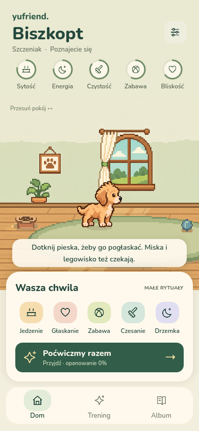
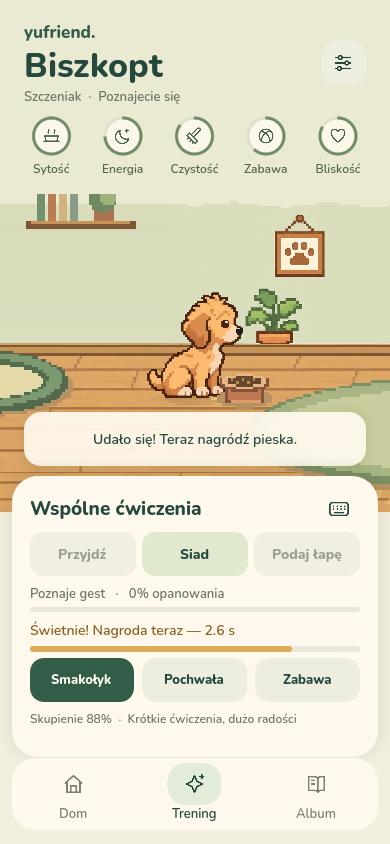
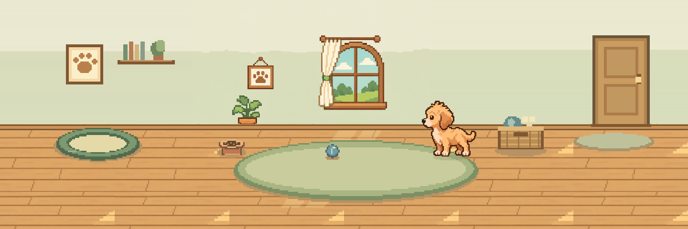

# YuFriend

Grywalny prototyp opieki nad szczeniakiem golden retrievera w Godocie. Jeden pokój, temperament kształtowany przez wspólne rytuały i nauka trzech komend. Działa lokalnie, bez konta, internetu i klucza API.

Interfejs skupia się na piesku i pokoju: kompaktowe wskaźniki potrzeb, stała nawigacja **Dom / Trening / Album** i akcje dostępne bez przewijania całego ekranu. W szerokim oknie sterowanie przenosi się do bocznego panelu. Pokój ma tło pixel art z oknem i drewnianą podłogą; dywan oraz klikalne przedmioty są rysowane osobno na siatce pikseli. Czytelny interfejs zachowuje wspólną paletę kremu, szałwii i zieleni.

<p>
  
  
</p>

Zrzuty z wersji komputerowej, wykonane na syntetycznym zapisie testowym.

## Dokumentacja

[Mapa dokumentacji projektu](docs/README.md) prowadzi przez opis gry, architekturę, mechaniki, model danych, testy i plan rozwoju. Szybkie uruchomienie jest poniżej, a materiały dla grafika znajdują się w [liście sprite’ów](docs/lista-spriteow-szczeniaka.md) oraz [instrukcji integracji](docs/integracja-spriteow.md).

## Uruchomienie

Projekt sprawdzono w Godot **4.7.2**, renderer **Compatibility**, na macOS. Otwórz `project.godot` w Godocie i wybierz **Uruchom projekt (F5)**. Możesz też uruchomić grę bez edytora:

```sh
'/Applications/Godot.app/Contents/MacOS/Godot' --path '/Volumes/Samsung SSD/YuFriend'
```

## Co można zrobić

- Przesuń pokój palcem lub przeciągnij myszą, aby obejrzeć jego dalszą część. „Do pieska” przywraca śledzenie; głaskanie i trening przybliżają kamerę.
- Dotknij pieska, aby go pogłaskać. Pies podchodzi do miski przed jedzeniem, do legowiska przed snem i goni toczącą się piłkę. Dotknięcie wolnej podłogi wskazuje cel spaceru.
- Pies sam pokazuje głód i nudę, a zmęczony idzie spać. Budzi się po odzyskaniu energii, także podczas przeliczania nieobecności. Kolejne głaskanie reaguje od razu; tylko przyrosty potrzeb i więzi mają 4 sekundy przerwy.
- W zakładce **Dom** te same czynności oraz czesanie są dostępne jako podpisane ikony.
- W **Treningu** wybierz „Siad”, użyj „Pokaż gest”, zaczekaj na wykonanie i wybierz nagrodę, gdy pojawi się odliczanie. Nagrody zastępują przyciski rozpoczęcia ćwiczenia. „Samodzielnie” sprawdza, czy pies już pamięta.
- Po osiągnięciu **25% siadu** odblokuje się „Podaj łapę”. „Przyjdź” jest dostępne od początku. Zmęczenie, głód i odpoczynek wpływają na gotowość do ćwiczeń.
- Ikona **klawiatury** w treningu pozwala wpisać polski zwrot, np. „usiądź” i „daj łapę”. To lokalny słownik komend.
- Ikona **ustawień** obok imienia otwiera profil. Zmienisz tam imię i zobaczysz cechy oraz nawyki. Docelowy styl to pixel art. **Album** pokazuje zdarzenia, które faktycznie zaszły w grze.

Ciekawość wpływa na spontaniczne spacery, cierpliwość na czas reakcji i nagrody, towarzyskość na potrzebę kontaktu, a wrażliwość na rozproszenie podczas zmęczenia. Zdarzenia z ukończonych dni powodują niewielki dryf cech i powstawanie nawyków, widocznych w Profilu i zachowaniu psa. Powrót po nieobecności nie usuwa nawyków. Dane są zachowywane po ponownym uruchomieniu; preferowana nagroda pozostaje stała. Reguły i ograniczenia opisuje [osobowość i nawyki](docs/osobowosc.md).

## Grafika i sprite’y

Gra korzysta z dostarczonego pakietu **22 klipów / 142 klatek** w stylu pixel art. Pies mruga, chodzi, siada, podaje łapę, macha ogonem, reaguje na głaskanie, je i śpi. Arkusze są podłączone z zachowaniem ich kolejności i czasów; kalibracja wyrównuje rozmiar sylwetki i linię podparcia. Wybrane poprawki `sleep` i `eat_loop` są uwzględnione.

Pixel art obowiązuje również dla starszych zapisów z `skin: simple`, bez zmiany tożsamości ani postępów. Usunięto przełącznik stylu, metodę `change_skin` i nieużywaną skórkę ilustracyjną. Pole `skin` pozostaje wyłącznie dla zgodności istniejących zapisów. Duże arkusze nadal mają drobne różnice proporcji i nie są równą siatką 64 × 64. [Opis dostawy i uwagi jakościowe](assets/sprites/puppy/pixel/README.md) wskazuje pozostałe poprawki.

Gotowa obsługa `AnimatedSprite2D` obejmuje 22 nazwy klipów, przejścia między pozycjami, odbicie lewo/prawo i indywidualny czas klatek. Nagroda czeka na zakończenie sztuczki lub dotarcie do celu. Można dostarczać animacje partiami.

- [Lista wymaganych sprite’ów](docs/lista-spriteow-szczeniaka.md)
- [Instrukcja wgrania sprite’ów i format manifestu](docs/integracja-spriteow.md)
- PNG i manifest produkcyjny: `assets/sprites/puppy/pixel/`
- [Tło pokoju i prompt](assets/art/environments/README.md)

## Szeroki pokój

Jeden świat 1440 × 480 zajmuje około 2–3 ekranów w podstawowym widoku. Ma sześć stacji: legowisko, miskę, piłkę, kosz z zabawkami, okno i drzwi. Pies porusza się w płytkim pasie podłogi; przedmioty mogą zasłaniać go od przodu, a interfejs pozostaje nieruchomy. Po ręcznym przesunięciu kamera czeka na „Do pieska” lub nową czynność. Przy głaskaniu i treningu zbliża się o 38%.



## Zapis

Stan trafia do `user://pet.json`, a poprzedni poprawny zapis do `user://pet.json.bak`. Na macOS standardowy katalog Godota dla tego projektu to `~/Library/Application Support/Godot/app_userdata/YuFriend/`. Można go otworzyć przez **Projekt → Otwórz folder danych użytkownika** w edytorze.

Format zapisu ma wersję 2. Odczyt wersji 1 zachowuje psa i postęp, uzupełnia nowe pola osobowości i zabezpiecza oryginał w `pet.json.v1`. Dotyczy to również odzyskiwania ze starszej kopii `.bak`. Jeżeli `.v1` jest cudzym lub nieprawidłowym zapisem, gra zachowuje go i tworzy własną kopię `.v1.<SHA-256 źródła>`; ten konflikt nie blokuje gry. Rzeczywisty błąd utworzenia lub sprawdzenia kopii nadal chroni oryginał przed nadpisaniem.

Zapis następuje po istotnych działaniach, okresowo i przy zamykaniu/wstrzymaniu. Uszkodzony główny plik jest odzyskiwany z poprawnej kopii. Nierozpoznanej nowszej wersji ani dwóch uszkodzonych plików gra nie nadpisuje: pokazuje komunikat i blokuje dalsze zmiany. Nieobecność jest liczona maksymalnie jako 8 godzin, potrzeby mają łagodną dolną granicę, a wyuczone komendy pozostają zachowane.

Nie uruchamiaj równolegle dwóch zwykłych instancji na tym samym zapisie. Do podglądu z osobnym stanem służy parametr `-- --qa`; testy używają własnych katalogów i usuwają swoje dane po zakończeniu.

## Struktura

| Miejsce | Odpowiedzialność |
|---|---|
| `scenes/Main.tscn`, `scripts/ui/` | Interfejs, rysowany pokój i ruch po scenie |
| `scripts/model/pet_state.gd` | Tożsamość, cechy, potrzeby, komendy, wspomnienia i walidacja danych |
| `scripts/systems/` | Opieka, trening, zapis i przebieg sesji |
| `scripts/pet/` | Wygląd, przejścia animacji i import klatek |
| `scripts/services/local_commands.gd` | Lokalne rozpoznawanie poleceń tekstowych |
| `data/skins/`, `data/animations/` | Konfiguracja pixel art i kompletny pakiet animacji; dawna ilustracja zachowana jako materiał referencyjny |
| `assets/art/reference/` | Dotychczasowe wzorce szczeniaka i prompty |
| `tests/` | Testy logiki, sprite’ów i interfejsu |

## Sprawdzenie projektu

Weryfikacja 14 listopada 2026: **208 sprawdzeń zakończonych powodzeniem** — 87 logiki, osobowości i zapisu, 38 importu i animacji oraz 83 interfejsu. Obejmuje wejście myszy i symulowanego dotyku w pokoju, dostępność nagród, dialogi, układy ekranu, nawyki po nieobecności i ochronę oryginału podczas migracji. Sprawdzono również dojście do przedmiotów, anulowanie opieki, wybudzanie, konflikt kopii `.v1`, powtarzane głaskanie i brak ponownego budowania statycznego tła podczas ruchu. Regresje panoramy sprawdzają przesuwanie bez przypadkowych akcji, granice kamery, zbliżenia, współrzędne po zmianie okna oraz dojście do nowych stacji. Zrzuty obejrzano także wizualnie.

Przy pierwszym otwarciu lub po dodaniu PNG poczekaj, aż Godot zaimportuje zasoby. Import można wykonać także bez okna:

```sh
'/Applications/Godot.app/Contents/MacOS/Godot' --headless --path '/Volumes/Samsung SSD/YuFriend' --editor --quit
```

Testy uruchamiane z katalogu projektu:

```sh
'/Applications/Godot.app/Contents/MacOS/Godot' --headless --path . --script res://tests/test_runner.gd
'/Applications/Godot.app/Contents/MacOS/Godot' --headless --path . --script res://tests/test_sprites.gd
'/Applications/Godot.app/Contents/MacOS/Godot' --path . --script res://tests/ui_smoke.gd
```

Ostatni test otwiera okno i zapisuje zrzuty do `test-results/`. Obejmuje układy 360 × 800, 390 × 844 i 540 × 960 oraz rzeczywiste skalowanie okien 320 × 640 i 1100 × 720. To test pulpitu; obsługa dotyku i cykl życia na fizycznym telefonie wymagają osobnego sprawdzenia po eksporcie.

## Kolejne etapy

1. Test użyteczności i balansu kilku krótkich sesji; eksport oraz sprawdzenie na telefonie.
2. Dopracowanie proporcji na styku klipów oraz docelowej siatki pixel art.
3. Dopasowanie pyska do miski, przedmioty opieki i dźwięki.
4. Opcjonalny backend AI, bogatsze zachowania i kolejne etapy wieku.

Obecna gra nie korzysta z płatnego API i nie generuje kosztów wywołań modeli. Pole `life_stage` jest przygotowane, ale dorastanie jeszcze nie działa. Szczegółowy zakres późniejszych prac opisuje [plan implementacji](docs/plan-implementacji.md).
