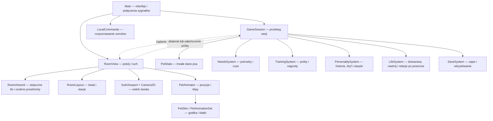
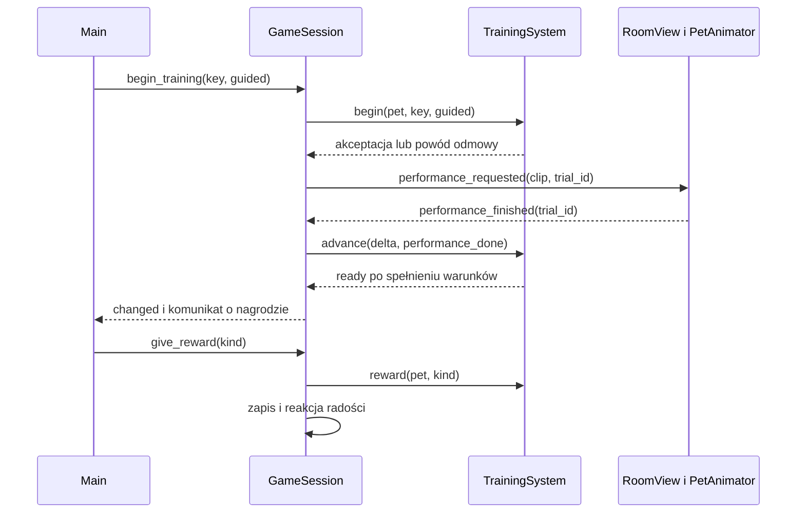

# Architektura YuFriend

[Mapa dokumentacji](README.md)

## Punkt wejścia i organizacja

[project.godot](../project.godot) uruchamia [Main.tscn](../scenes/Main.tscn). Scena zawiera główny `Control` ze skryptem [main.gd](../scripts/ui/main.gd). Interfejs, pokój, dialogi i obiekt sesji powstają w GDScripcie podczas uruchomienia; nie są osobnymi scenami do edycji w drzewie `Main.tscn`.

Projekt używa renderera Compatibility i bazowego obszaru 390 × 844. Okno pulpitu ma domyślnie 430 × 930. Skalowanie to `canvas_items` z aspektem `expand`. Nie ma autoloadów, bazy danych, backendu ani dodatkowego frameworka aplikacji.

`Main._fit_room()` układa pełną wysokość pokoju i pływające kontrolki w bezpiecznym obszarze. [`DisplayServer.get_display_safe_area()`](https://docs.godotengine.org/en/stable/classes/class_displayserver.html#class-displayserver-method-get-display-safe-area) jest przeliczane z fizycznych pikseli na współrzędne UI; na pulpicie używany jest obszar okna, a testy mogą podać symulowane marginesy. `IconActionButton` łączy akcję, poziom potrzeby, procent i czas oczekiwania. `NeedIndicator.level_color()` współdzieli progi kolorów. Nagłówek pokazuje imię i więź, karta psa jest oddzielona od ustawień, a album ma pełną wysokość. Profil i raport powrotu przewijają zawartość wewnątrz ograniczonego dialogu. Font Nunito jest dołączony wraz z licencją w `assets/fonts/`.

Pokój jest osobnym światem 2D w `SubViewport`, wyświetlanym przez `Sprite2D` pod HUD-em. `Camera2D` przesuwa tylko świat; zbliżenie realizuje całkowite powiększenie tekstury pokoju, a potrzeby, panele i komunikat pozostają w interfejsie. [RoomLayout](../scripts/model/room_layout.gd) określa wymiary 1440 × 360, płytki pas chodzenia oraz sześć stacji. Ich pozycje nie zmieniają się wraz z wielkością okna.

`RoomArtwork` składa panoramę z fragmentów istniejącego tła pixel art i osobnych przedmiotów. Tło ma zachowaną listę rysowania, przedmioty są oddzielnymi węzłami, a `actors.y_sort_enabled` ustawia kolejność psa i kosza/miski/piłki według głębokości. Legowisko i drzwi są nad tłem, lecz za postacią. [Opis zasobów](../assets/art/environments/README.md) wskazuje sposób składania grafiki.

## Odpowiedzialności modułów

| Moduł | Rola |
|---|---|
| [PetState](../scripts/model/pet_state.gd) | Tożsamość, cechy, potrzeby, komendy, relacja, dziennik oraz serializacja i walidacja |
| [GameSession](../scripts/systems/game_session.gd) | Łączy systemy; przyjmuje działania gracza, blokuje nakładające się czynności, steruje zegarami i zapisem |
| [NeedsSystem](../scripts/systems/needs_system.gd) | Zmiany potrzeb i zmęczenia w czasie oraz jednorazowe efekty działań |
| [TrainingSystem](../scripts/systems/training_system.gd) | Warunki rozpoczęcia, wynik próby, czas nagrody i naliczanie postępu |
| [PersonalitySystem](../scripts/systems/personality_system.gd) | Dziennik zdarzeń, dryf cech, nawyki i sprawdzanie propozycji zmian osobowości |
| [LifeSystem](../scripts/systems/life_system.gd) | Odkrywanie dziwactw, stały nastrój dnia, symulowane relacje z nieobecności i powitania; bez nagradzania fikcyjnej aktywności gracza |
| [InitiativeSystem](../scripts/systems/initiative_system.gd) | Dobór zaproszeń według temperamentu, nastroju i zapamiętanych odpowiedzi; ograniczona historia reakcji |
| [CompanionVoice](../scripts/systems/companion_voice.gd) | Tylko odczyt stanu: priorytet potrzeby/zaproszenia, spokojne myśli i potwierdzone wpisami wspomnienia; 45-sekundowy odstęp treści |
| [TouchPlaySystem](../scripts/systems/touch_play_system.gd) | Fazy liny, kubków i złapania piłki; czyste reguły gestów bez zależności od widoku |
| [TouchPlayView](../scripts/ui/touch_play_view.gd) | Rysuje linę i kubki, pokazuje psa, obsługuje jeden palec lub mysz i przekazuje znormalizowane współrzędne |
| [SaveSystem](../scripts/systems/save_system.gd) | Odczyt, walidowany zapis do pliku tymczasowego i odzyskiwanie kopii |
| [LocalCommands](../scripts/services/local_commands.gd) | Normalizuje wpisany tekst i zwraca identyfikator istniejącej komendy |
| [RoomView](../scripts/ui/room_view.gd) | Tworzy świat i kamerę, odróżnia tapnięcie od przesuwania, przelicza ekran/świat, prowadzi ruch i zbliżenia |
| [RoomLayout](../scripts/model/room_layout.gd) | Stałe współrzędne, granice ruchu i definicje stacji: miejsce, punkt dojścia, klip, potrzeba oraz efekty |
| [RoomArtwork](../scripts/ui/room_artwork.gd) | Zachowuje statyczne listy rysowania tła i przedmiotów; osobne instancje obsługują cień i piłkę |
| [PetAnimator](../scripts/pet/pet_animator.gd) | Dobiera przejścia między pozycjami i odtwarza klipy lub zastępcze ilustracje |
| [PetSkin](../scripts/pet/pet_skin.gd), [PetAnimationSet](../scripts/pet/pet_animation_set.gd) | Zasoby wyglądu, klatek, skali i punktu podparcia |
| [SpriteImporter](../scripts/pet/sprite_importer.gd) | Waliduje manifest i buduje zasób z PNG lub fragmentów arkusza |

`PetState`, systemy potrzeb, treningu i zapisu są obiektami `RefCounted`. Nie potrzebują interfejsu do sprawdzenia reguł. `GameSession` jest węzłem aktualizowanym przez `_process(delta)`, `RoomView` to `Control`, a `PetAnimator` to `Node2D` z `AnimatedSprite2D`.

## Przebieg uruchomienia

1. `Main` buduje interfejs i łączy sygnały sesji z pokojem.
2. Wybiera ścieżkę zapisu: normalną, `--qa` lub nadpisaną przez test.
3. `GameSession.start()` wczytuje psa i ustala, czy zapis jest dostępny do modyfikacji.
4. `NeedsSystem.catch_up()` przelicza nieobecność.
5. Jeśli pies nadal odpoczywa po przeliczeniu nieobecności, sesja umieszcza go w legowisku i zleca sen.
6. Sesja próbuje zapisać stan i odświeża interfejs; `RoomView` używa jednego produkcyjnego pakietu pixel art również dla dawnych zapisów.

Zegary czynności, animacji i próby treningowej nie są wczytywane z dysku. Po restarcie wraca stan psa, a nowa próba musi zostać rozpoczęta od początku.

## Umowa między sesją i widokiem

Połączenia są tworzone w `Main._ready()`.

| Sygnał | Odbiorca i znaczenie |
|---|---|
| `GameSession.changed` | `Main._refresh()` odświeża dane i dostępność przycisków |
| `feedback(text)` | Pokazuje dymek przy psie na 3,5–6 sekund; zwykły refresh nie przedłuża jego życia |
| `care_completed(action, gains)` | Pokazuje rzeczywiście naliczone dodatnie przyrosty i błysk obwódki; nie jest emitowany ponownie za to samo dojście |
| `RoomView.first_pan` | Zapisuje zamknięcie wskazówki przesuwania w `ui.cfg` obok zapisu psa |
| `save_status(ok)` | Odświeża informację o zapisie |
| `clip_requested(clip)` | `RoomView.play_clip()` uruchamia zwykłą reakcję lub pozycję |
| `destination_requested(world_position)` | `RoomView.move_to()` ustawia cel `Vector2` we współrzędnych świata |
| `approach_requested(action, token)` | Widok ustawia drogę do miski, legowiska lub piłki; nie przyznaje efektów |
| `RoomView.station_reached(token)` | Sesja przyjmuje tylko aktualne dojście i jednorazowo wykonuje opiekę lub sygnalizuje potrzebę |
| `attention_requested(close_up)` | Przywraca śledzenie psa, opcjonalnie z krótkim zbliżeniem |
| `activity_cancelled` | Widok zatrzymuje ruch i usuwa poprzedni cel |
| `place_requested(action)` | Odtworzenie położenia w legowisku po wczytaniu / wznowieniu |
| `performance_requested(clip, trial_id)` | `RoomView.play_performance()` rozpoczyna prezentację konkretnej próby |
| `RoomView.floor_tapped(world_position)` | `GameSession.move_to()` sprawdza możliwość ruchu |
| `RoomView.care_requested(action)` | Akcja opieki po dotknięciu psa, miski, piłki lub legowiska; nadal podlega regułom `GameSession.act()` |
| `destination_reached` | Kończy zwykłe chodzenie w sesji |
| `performance_finished(trial_id)` | Zgłasza ukończenie prezentacji próby do sesji |

Cele ruchu to `Vector2` we współrzędnych świata. `RoomLayout.clamp_walk()` ogranicza je do prostokąta od (95, 286) do (1345, 328). Podstawowy chód ma 38,4 jednostki świata na sekundę (12,8 piksela logicznego). Klip gra w oryginalnym tempie 1×, także przy podążaniu za piłką. Szybszy pościg wymaga osobnego klipu biegu i pomiaru długości kroku. Ruch zaczyna się dopiero po przejściu animatora do `walk`. Dla „przyjdź” widok wyznacza cel około 150 jednostek od obecnego położenia, zamiast dawnego ułamka szerokości ekranu.

## Zaproszenia i zabawy

`GameSession` utrzymuje jedno tymczasowe zaproszenie. `Main` przekazuje dostępność uwagi na podstawie fokusu, zakładki, dialogów i widoku całego pokoju. `CompanionVoice` wybiera treść górnego dymka, który przy zaproszeniu daje odpowiedź lub „Później”. Osobne `invitation_presented` zatrzymuje zegar odpowiedzi, kiedy pilniejsza potrzeba zasłania zaproszenie. Przycisk ponownie sprawdza bieżącą akcję przed przekazaniem jej do istniejącej sesji. Ten stan prezentacji nie zmienia schematu zapisu ani kamery pokoju. `initiative_requested(kind)` uruchamia prezentację w pokoju; samodzielne podejście korzysta z istniejącego tokenu stacji i można je przerwać odpowiedzią.

`ball_aim_requested` kieruje kamerę do piłki. Gest w `RoomView` emituje `ball_thrown(target)`, a sesja po walidacji wysyła `ball_throw_requested(target, token)`. Widok odtwarza lot oraz pościg i potwierdza aktualny token dopiero po lądowaniu i dojściu. Sesja rozlicza wynik dokładnie raz. Anulowanie unieważnia token, gest i lot.

`touch_game_opened(kind)` otwiera scenę liny lub kubków; `TouchPlayView` wysyła `pressed_at`, `moved_to`, `released_at` do sesji. `TouchPlaySystem` decyduje o wyniku. Wyłącznie sesja przyznaje efekty z trwałym odstępem 30 sekund. Zamknięcie dialogu lub wstrzymanie resetuje model i uchwyt palca, a `touch_game_closed` zamyka widok. Stan rund nie jest zapisywany; pamięć reakcji i liczników znajduje się w `PetState.social` schematu v4.

## Synchronizacja treningu

`TrainingSystem` ustala wynik i minimalny czas reakcji. `GameSession` rozpoczyna próbę z `performance_done = false`. Pokój potwierdza zakończenie sztuczki; dla „przyjdź” czeka również na dotarcie do celu. Dopiero potwierdzenie i upływ czasu reakcji pozwalają otworzyć okno nagrody.

Każda próba ma `trial_id`. `performance_finished()` uznaje tylko aktualny identyfikator, fazę `attempt` i aktywną sesję. Anulowanie zmienia identyfikator, więc spóźnione potwierdzenie poprzedniej próby nie przyznaje nagrody.

Schemat pokazuje udaną próbę. Odmowa lub niewykonanie komendy kończą się komunikatem bez przejścia do nagrody. Reguły faz i obliczeń opisują [mechaniki gry](mechaniki-gry.md).

## Animacje i stan wizualny

Animator rozróżnia pozycje `stand`, `sit`, `lie`, `sleep` i `eat`. Każdy z 22 klipów ma jawną pozycję początkową i końcową. Przykładowo podanie łapy w staniu wymaga najpierw `sit_down`; przejście ze snu do chodu wymaga `wake_up` i `get_up`.

W danym momencie oczekuje jedno żądanie klipu. Kolejne żądanie zastępuje oczekujące, a trwający klip jednorazowy kończy się przed zmianą. Dla klipu jednorazowego `request_completed(id)` oznacza zakończenie; dla pętli — wejście do niej po przejściach. Pokój dodaje osobny warunek dotarcia przy przywołaniu.

Czas dostarczonego klipu jednorazowego to suma mnożników czasu klatek podzielona przez FPS. Brak klipu uruchamia grafikę zastępczą z czasem z `PetAnimator.CLIPS`. Ręczne `PetSkin.frames` ma pierwszeństwo przed pakietem wskazanym przez `animation_pack_path`. `PetAnimationSet.clip_layouts` przenosi skalę klipów i punkty podparcia poszczególnych klatek. Regiony `AtlasTexture` pozwalają użyć dostarczonych nierównych pól bez przerysowania PNG. Filtr alfa w skórce działa wyłącznie podczas renderowania. [Integracja sprite’ów](integracja-spriteow.md) opisuje format wejściowy.

`GameSession.pose` opisuje pozycję oczekiwaną przez rozgrywkę. `PetAnimator.pose` opisuje pozycję osiągniętą po zakończeniu przejścia. Nie należy traktować ich jako zawsze identycznych w trakcie animacji.

## Cykl życia aplikacji

Zamknięcie okna wywołuje zapis, a następnie kończy grę. Utrata fokusu na pulpicie wywołuje zapis, lecz sama nie wstrzymuje symulacji. Powiadomienie o wstrzymaniu aplikacji anuluje próbę i token niedokończonego dojścia, zatrzymuje ruch oraz aktualizację sesji, a następnie zapisuje stan. Wznowienie przelicza nieobecność i odtwarza pozycję odpoczynku lub stania.

Przy rozbudowie reguły opieki i treningu powinny pozostać w systemach, a interfejs powinien wywoływać metody sesji. Zmiana grafiki nie powinna bezpośrednio zwiększać umiejętności ani przepisywać danych psa.

## Opieka w pokoju i kamera

Sesja zleca dojście z tokenem. `RoomView` odczytuje punkt stacji z `RoomLayout`; dojście uruchamia efekt opieki w sesji. Pozycja piłki jest zmienna, pozostałe stacje mają stałe współrzędne. Przy podmianie grafiki można zachować ich kontrakt z logiką.

Pokój jest rysowany na całą wysokość. `content_bottom` wyznacza dół sceny nad sterowaniem; kamera zostawia pod nim dodatkową podłogę, żeby łapy psa nie chowały się pod przyciskami. Współrzędne rozgrywki nadal wynoszą 1440 × 360, a siatka ma 3 jednostki świata na piksel logiczny. W pionie kamera wybiera największe całkowite powiększenie mieszczące co najmniej 480 jednostek świata — początkowy kadr obejmuje całego psa, miskę i piłkę. Nadmiar wysokości pomiędzy paskiem narzędzi a panelem opieki przenosi w 75% pod scenę jako podłogę, ograniczając pustą ścianę nad oknem. Poziomy układ zachowuje skalę wyznaczaną przez około 200 pikseli logicznych. Dodatkowe 2× wymaga miejsca także w poziomie; gdy zbliżenie zajmuje dostępny pion, dodatkowe przesunięcie zanika.

Kamera łagodnie śledzi psa. Viewport ma po pikselu marginesu; shader `room_scroll.gdshader` przesuwa próbkowanie o pozostałą część ruchu zaokrągloną do fizycznego piksela. Wolny gest nie przeskakuje o cały powiększony piksel grafiki. `Camera2D.zoom` pozostaje 1. Rozmiar i pozycja `Sprite2D` uwzględniają transformację końcową viewportu oraz `canvas_items`, zachowując równe piksele również przy ułamkowym skalowaniu. Dymek i przyrost są elementami UI przeliczanymi z pozycji psa w każdej klatce. Wskazówka gestu nie wraca po zapisaniu `tutorial/room_dragged` w `ui.cfg`.

Dotknięcie jest rozpoznawane po puszczeniu palca. Ruch o co najmniej 9 jednostek uruchamia przesuwanie widoku i wyklucza akcję dotknięcia. Ręcznie ustawiona kamera pozostaje na miejscu do użycia „Do pieska” lub rozpoczęcia nowej czynności. `world_to_screen()` i `screen_to_world()` obsługują wszystkie strefy kliknięcia po panoramowaniu i zoomie. Maski alfa psa powstają dopiero przy dotknięciu danej klatki; na pierwszym planie pierwszeństwo mają piłka i przedmioty zasłaniające psa.

Zmiana rozmiaru okna przelicza wyłącznie widok i kamerę — nie pozycje psa i przedmiotów. `RoomArtwork.draw_count` sprawdza, że chód nie przebudowuje tła. Zmiana rozmiaru viewportu może jednorazowo odświeżyć listę. To kontrola listy rysowania na CPU, a nie pomiar baterii lub wydajności GPU na telefonie.

## Efekty dźwiękowe

`GameSession.sound_requested` zgłasza przyjęte czynności (jedzenie, głaskanie, czesanie, nagroda i głód przy misce). `RoomView.sound_requested` zgłasza kroki po przebytej odległości i początek toczenia piłki. `Main` przekazuje oba sygnały do `SoundEffects`. System ładuje 20 lokalnych WAV w 10 grupach, losuje warianty, ogranicza odtwarzanie do czterech głosów i zatrzymuje efekty w tle. Muzyka i efekty współdzielą `audio.cfg`, zachowując niezależne przełączniki. Źródła i archiwalne próbki są wyłączone z eksportu.

Przypisanie zdarzenia nie gwarantuje poprawnej treści nagrania: po zgłoszeniu szczekania w krokach podmieniono 11 próbek. Kroki mają 160 ms. Szczegóły generowania, kontrola i ograniczenia są w [dokumentacji audio](../assets/audio/sfx/README.md).

### Dwa kadry pokoju

`RoomView.show_overview()` mieści całą panoramę pomiędzy nagłówkiem i panelem. Na wyjściu węższym niż 480 pikseli używa siatki przeglądowej 6 jednostek świata zamiast 3; powiększenie gotowej tekstury nadal jest całkowite. Geometria, pozycje psa i stacji pozostają niezmienne. Dotknięcie panoramy wyłącznie wybiera miejsce zbliżenia. `focus_pet()` przywraca szczegółowy widok i śledzenie; czynności opieki również przywołują psa do kadru.
