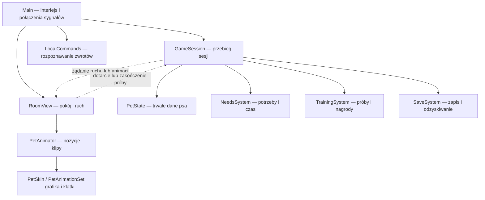
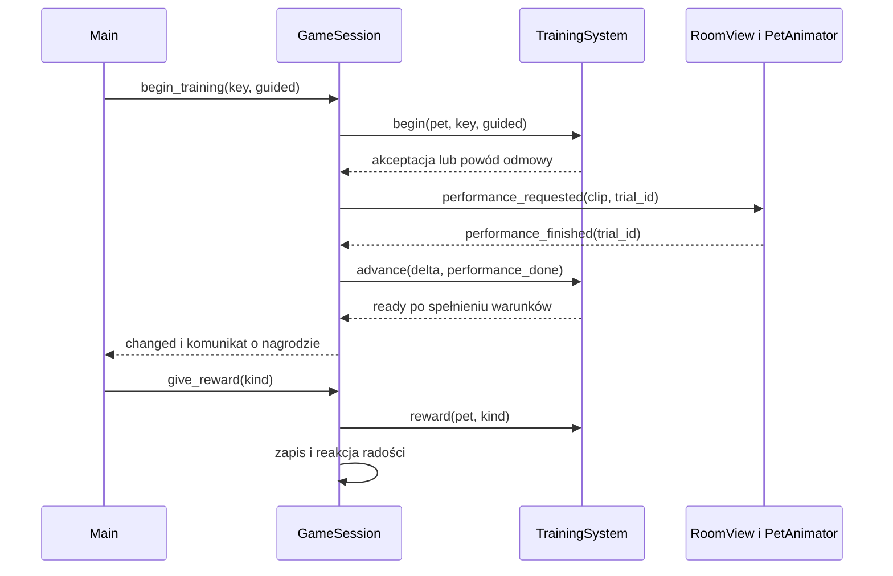

# Architektura YuFriend

[Mapa dokumentacji](README.md)

## Punkt wejścia i organizacja

[project.godot](../project.godot) uruchamia [Main.tscn](../scenes/Main.tscn). Scena zawiera główny `Control` ze skryptem [main.gd](../scripts/ui/main.gd). Interfejs, pokój, dialogi i obiekt sesji powstają w GDScripcie podczas uruchomienia; nie są osobnymi scenami do edycji w drzewie `Main.tscn`.

Projekt używa renderera Compatibility i bazowego obszaru 390 × 844. Okno pulpitu ma domyślnie 430 × 930. Skalowanie jest ustawione na `canvas_items`. Nie ma autoloadów, bazy danych, backendu ani dodatkowego frameworka aplikacji.

## Odpowiedzialności modułów

| Moduł | Rola |
|---|---|
| [PetState](../scripts/model/pet_state.gd) | Tożsamość, cechy, potrzeby, komendy, relacja, dziennik oraz serializacja i walidacja |
| [GameSession](../scripts/systems/game_session.gd) | Łączy systemy; przyjmuje działania gracza, blokuje nakładające się czynności, steruje zegarami i zapisem |
| [NeedsSystem](../scripts/systems/needs_system.gd) | Zmiany potrzeb i zmęczenia w czasie oraz jednorazowe efekty działań |
| [TrainingSystem](../scripts/systems/training_system.gd) | Warunki rozpoczęcia, wynik próby, czas nagrody i naliczanie postępu |
| [SaveSystem](../scripts/systems/save_system.gd) | Odczyt, walidowany zapis do pliku tymczasowego i odzyskiwanie kopii |
| [LocalCommands](../scripts/services/local_commands.gd) | Normalizuje wpisany tekst i zwraca identyfikator istniejącej komendy |
| [RoomView](../scripts/ui/room_view.gd) | Rysuje pokój, obsługuje wejście, przesuwa psa i przekazuje zakończenie ruchu |
| [PetAnimator](../scripts/pet/pet_animator.gd) | Dobiera przejścia między pozycjami i odtwarza klipy lub zastępcze ilustracje |
| [PetSkin](../scripts/pet/pet_skin.gd), [PetAnimationSet](../scripts/pet/pet_animation_set.gd) | Zasoby wyglądu, klatek, skali i punktu podparcia |
| [SpriteImporter](../scripts/pet/sprite_importer.gd) | Waliduje manifest i buduje zasób z PNG lub fragmentów arkusza |

`PetState`, systemy potrzeb, treningu i zapisu są obiektami `RefCounted`. Nie potrzebują interfejsu do sprawdzenia reguł. `GameSession` jest węzłem aktualizowanym przez `_process(delta)`, `RoomView` to `Control`, a `PetAnimator` to `Node2D` z `AnimatedSprite2D`.

## Przebieg uruchomienia

1. `Main` buduje interfejs i łączy sygnały sesji z pokojem.
2. Wybiera ścieżkę zapisu: normalną, `--qa` lub nadpisaną przez test.
3. `GameSession.start()` wczytuje psa i ustala, czy zapis jest dostępny do modyfikacji.
4. `NeedsSystem.catch_up()` przelicza nieobecność.
5. Jeśli pies odpoczywał, sesja zleca pozycję snu.
6. Sesja próbuje zapisać stan i odświeża interfejs; `Main` dobiera styl grafiki z profilu.

Zegary czynności, animacji i próby treningowej nie są wczytywane z dysku. Po restarcie wraca stan psa, a nowa próba musi zostać rozpoczęta od początku.

## Umowa między sesją i widokiem

Połączenia są tworzone w `Main._ready()`.

| Sygnał | Odbiorca i znaczenie |
|---|---|
| `GameSession.changed` | `Main._refresh()` odświeża dane i dostępność przycisków |
| `feedback(text)` | Aktualizuje komunikat dla gracza |
| `save_status(ok)` | Odświeża informację o zapisie |
| `clip_requested(clip)` | `RoomView.play_clip()` uruchamia zwykłą reakcję lub pozycję |
| `destination_requested(ratio)` | `RoomView.move_to()` ustawia poziomy cel ruchu |
| `performance_requested(clip, trial_id)` | `RoomView.play_performance()` rozpoczyna prezentację konkretnej próby |
| `RoomView.floor_tapped(ratio)` | `GameSession.move_to()` sprawdza możliwość ruchu |
| `destination_reached` | Kończy zwykłe chodzenie w sesji |
| `performance_finished(trial_id)` | Zgłasza ukończenie prezentacji próby do sesji |

Współrzędna `ratio` to część szerokości pokoju, a nie piksele. Zakres ruchu wynosi 0,23–0,77, a prędkość 0,24 szerokości pokoju na sekundę. Ruch zaczyna się dopiero wtedy, gdy animator przejdzie do `walk`.

## Synchronizacja treningu

`TrainingSystem` ustala wynik i minimalny czas reakcji. `GameSession` rozpoczyna próbę z `performance_done = false`. Pokój potwierdza zakończenie sztuczki; dla „przyjdź” czeka również na dotarcie do celu. Dopiero potwierdzenie i upływ czasu reakcji pozwalają otworzyć okno nagrody.

Każda próba ma `trial_id`. `performance_finished()` uznaje tylko aktualny identyfikator, fazę `attempt` i aktywną sesję. Anulowanie zmienia identyfikator, więc spóźnione potwierdzenie poprzedniej próby nie przyznaje nagrody.

Schemat pokazuje udaną próbę. Odmowa lub niewykonanie komendy kończą się komunikatem bez przejścia do nagrody. Reguły faz i obliczeń opisują [mechaniki gry](mechaniki-gry.md).

## Animacje i stan wizualny

Animator rozróżnia pozycje `stand`, `sit`, `lie`, `sleep` i `eat`. Każdy z 22 klipów ma jawną pozycję początkową i końcową. Przykładowo podanie łapy w staniu wymaga najpierw `sit_down`; przejście ze snu do chodu wymaga `wake_up` i `get_up`.

W danym momencie oczekuje jedno żądanie klipu. Kolejne żądanie zastępuje oczekujące, a trwający klip jednorazowy kończy się przed zmianą. Dla klipu jednorazowego `request_completed(id)` oznacza zakończenie; dla pętli — wejście do niej po przejściach. Pokój dodaje osobny warunek dotarcia przy przywołaniu.

Czas dostarczonego klipu jednorazowego to suma mnożników czasu klatek podzielona przez FPS. Brak klipu uruchamia grafikę zastępczą z czasem z `PetAnimator.CLIPS`. Ręczne `PetSkin.frames` ma pierwszeństwo przed pakietem wskazanym przez `animation_pack_path`. [Integracja sprite’ów](integracja-spriteow.md) opisuje format wejściowy.

`GameSession.pose` opisuje pozycję oczekiwaną przez rozgrywkę. `PetAnimator.pose` opisuje pozycję osiągniętą po zakończeniu przejścia. Nie należy traktować ich jako zawsze identycznych w trakcie animacji.

## Cykl życia aplikacji

Zamknięcie okna wywołuje zapis, a następnie kończy grę. Utrata fokusu na pulpicie wywołuje zapis, lecz sama nie wstrzymuje symulacji. Powiadomienie o wstrzymaniu aplikacji anuluje próbę, zatrzymuje aktualizację sesji i zapisuje stan. Wznowienie przelicza nieobecność i odtwarza pozycję odpoczynku lub stania.

Przy rozbudowie reguły opieki i treningu powinny pozostać w systemach, a interfejs powinien wywoływać metody sesji. Zmiana grafiki nie powinna bezpośrednio zwiększać umiejętności ani przepisywać danych psa.
