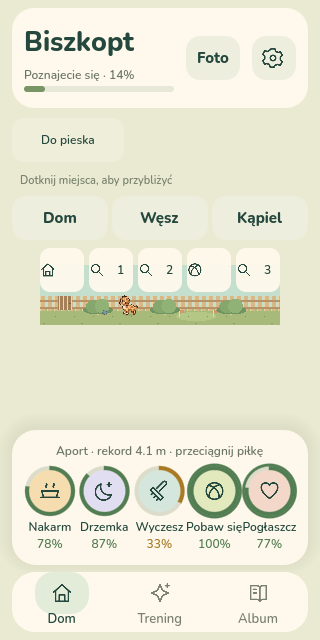
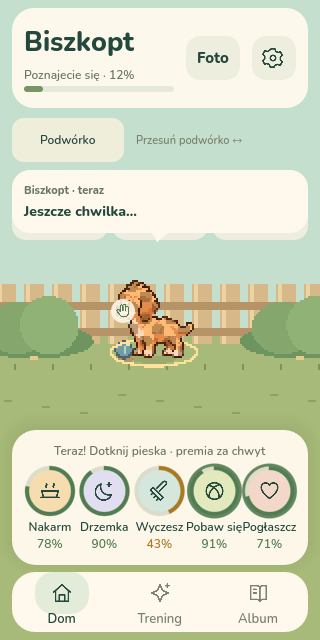
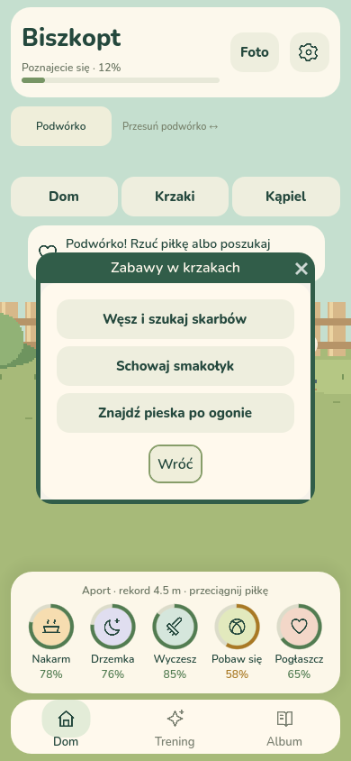
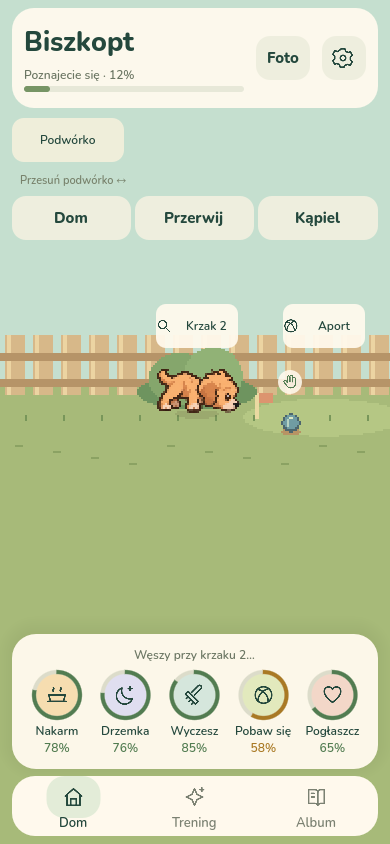
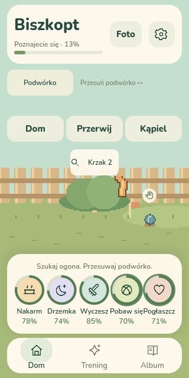

# Mechaniki gry YuFriend

[Mapa dokumentacji](README.md)

Wartości poniżej opisują prototyp z 15 listopada 2026. Są parametrami do dalszego sprawdzenia w rozgrywce. Ich źródłami są [NeedsSystem](../scripts/systems/needs_system.gd), [TrainingSystem](../scripts/systems/training_system.gd), [GameSession](../scripts/systems/game_session.gd) i [PetState](../scripts/model/pet_state.gd).

## Potrzeby

Wysoki wskaźnik oznacza zaspokojoną potrzebę. Zmiany zachodzą proporcjonalnie do czasu `delta`, a nie liczby klatek.

| Potrzeba | Klucz danych | Wartość początkowa | Pasywny spadek na godzinę |
|---|---|---:|---:|
| Sytość | `fullness` | 78 | 7 |
| Energia | `energy` | 76 | 5 |
| Czystość | `hygiene` | 85 | 3 |
| Zabawa | `play` | 58 | 7 |
| Bliskość | `contact` | 65 | `5 × (0,7 + 0,6 × sociability)` |

Pasywna aktualizacja ogranicza potrzeby do 15–100. Jednorazowe efekty czynności są ograniczane do 0–100, więc dolna granica pasywnej aktualizacji nie jest globalną walidacją każdej zmiany. Gra nie usuwa psa ani umiejętności przy niskich potrzebach.

Podczas nieobecności symulowane jest najwyżej 8 godzin. Zasady czasu i wznowienia opisuje [zapis danych](model-danych-i-zapis.md).

## Działania opiekuna

Karmienie, odpoczynek i zabawa zaczynają się od dojścia do przedmiotu. Pies idzie do miski, zanim dostanie sytość; do legowiska, zanim zacznie regenerować energię; goni toczącą się piłkę, zanim dostanie efekt zabawy. Po dojściu jedzenie i zabawa trwają 2 sekundy, a wtedy zaczyna się ich czas ponownego użycia. Animator kończy aktualne przejście przed zmianą klipu. Czesanie działa w miejscu przez 2 sekundy. Przejście aplikacji w tło anuluje niedokończone dojście bez naliczania efektów.

Ikony opieki w zakładce Dom i dotknięcia przedmiotów korzystają z reguł sesji. „Pobaw się” otwiera wybór trzech zabaw dotykowych; krótkie stuknięcie piłki w pokoju zachowuje prosty pościg opisany w tabeli. Głaskanie od razu reaguje na kolejne dotknięcie, również podczas zwykłego spaceru lub zaproszenia psa. Przyrost bliskości, zabawy, więzi oraz zdarzenie w historii są naliczane najwyżej raz na 4 sekundy. Sama reakcja nie wymaga czekania na ten licznik; trening, posiłek i sen nadal mają pierwszeństwo.

| Działanie | Klucz | Efekt | Ponowne użycie |
|---|---|---|---:|
| Jedzenie | `feed` | Sytość +22 | 10 s |
| Głaskanie | `pet` | Bliskość +18, zabawa +3, więź +0,6 | Reakcja od razu; efekty co 4 s |
| Zabawa | `play` | Zabawa +24, bliskość +8, energia −5, czystość −3 | 8 s |
| Czesanie | `clean` | Czystość +25, bliskość +5 | 12 s |
| Odpoczynek / budzenie | `rest` | Ustawia `resting` po dojściu do legowiska; budzenie kończy odpoczynek | Bez osobnego czasu ponownego użycia |

W odpoczynku przyrost energii wynosi 0,8 punktu na sekundę aktywnej gry lub 18 punktów na godzinę nieobecności. W tym samym czasie działa zwykły pasywny ubytek energii. Pies sam budzi się przy energii co najmniej 85 po minimum 6 sekundach aktywnej drzemki; można go też obudzić wcześniej. Przeliczenie nieobecności kończy sen po dojściu do 85 i liczy resztę czasu już na jawie. Przykład: z energią 20 pies po 5 godzinach osiąga 85, a po kolejnych 3 godzinach czuwania ma 70. Nieobecność nadal jest ograniczona do 8 godzin.

Trening i wykonywana opieka chronią swoje czynności przed nakładaniem. Zaproszenia wynikające z potrzeb lub nawyków oraz zwykły spacer można od razu przerwać opieką, treningiem lub nowym celem na podłodze. Dotyczy to spaceru samodzielnego i zleconego przez gracza. Dojście do wybranej stacji oraz rozpoczęty trening pozostają chronione. Śpiącego psa trzeba obudzić przed opieką i treningiem. Przy problemie z odczytem zapisu zmiany stanu są zablokowane.

Przy sytości, zabawie lub czystości co najmniej 95 odpowiadająca opieka daje komunikat o zaspokojeniu potrzeby, bez dojścia, efektów ani wpisu do historii. Dotyczy to także zabawy przy koszu. Głaskanie nie ma takiego progu. Dotknięcie psa podczas jedzenia wyjaśnia, że właśnie je, i nie przerywa posiłku. Przy zbliżeniu piłka odsuwa się poza obszar łap.

## Dymek Glorii

W zakładce Dom, pod przyciskiem „Cały pokój”, znajduje się dymek z imieniem psa i krótkim tekstem w pierwszej osobie. To nakładka interfejsu: nie zmienia kadru, skali ani pozycji przedmiotów w pokoju.

Dymek najpierw opisuje trwającą czynność lub sen. Gdy pies jest wolny, wybiera najniższą potrzebę poniżej 40%. Energia poniżej 28% lub zmęczenie co najmniej 75 dają pierwszeństwo odpoczynkowi przed zabawą. Następne w kolejności jest aktywne zaproszenie psa, a przy zaspokojonych potrzebach — myśl zależna od nastroju, odkrytego dziwactwa albo wspomnienie rzeczywistego wydarzenia z albumu. Spokojna treść zmienia się co 45 sekund widoczności lub po zmianie kontekstu, np. zapisaniu nowego wspomnienia; zwykłe odświeżenie interfejsu jej nie losuje.

Przycisk uruchamia odpowiadającą opiekę, wybór zabawy, przyjęcie zaproszenia lub album. Podlega istniejącym regułom sesji i czasom oczekiwania; samo pokazanie dymka niczego nie nagradza. Zaproszenie ma też „Później”, a jego licznik odpowiedzi zatrzymuje się, gdy pilniejsza potrzeba zajmuje dymek. Dymek znika w treningu, albumie, dialogach, widoku całego pokoju i w tle aplikacji. Krótkie komunikaty po działaniach nadal pojawiają się przy psie.

## Zabawy dotykiem

Przycisk **Pobaw się** otwiera wybór trzech gier. Każda działa palcem i myszą. Wymagają obudzonego psa, energii co najmniej 28, zmęczenia poniżej 85 i braku innej trwającej czynności. Można bawić się także przy pełnej potrzebie zabawy.

| Zabawa | Sterowanie i ukończenie |
|---|---|
| Piłka | Przeciągnij piłkę w pokoju w lewo lub prawo i puść. Łuk pokazuje cel; pies idzie do miejsca lądowania. Dopiero dogonienie piłki kończy rundę. Krótkie stuknięcie zachowuje prosty pościg. |
| Przeciąganie liny | Chwyć widoczny węzeł, pociągnij w prawo i puść. Piesek pociągnie linę do siebie, po czym możesz znów chwycić węzeł. Trzy takie wymiany kończą rundę. Samo trzymanie i drżenie palca nie zastępują Twojego pociągnięcia. Anulowany dotyk wycofuje niedokończoną wymianę. |
| Szukanie smakołyka | Dotknij kubka, żeby schować pod nim smakołyk, a następnie wybierz „Szukaj!”. Piesek sam podchodzi do kubków w losowej kolejności i znajduje kryjówkę. Po odsłonięciu smakołyka wybierz „Brawo!”, żeby pochwalić psa i zakończyć rundę. Użytkownik przygotowuje zabawę, a pies szuka; nie ma zgadywania przez gracza. |

Udana runda zwiększa zabawę o 18, bliskość o 6 i więź o 0,35, zużywając 3 energii i 1 czystości. Te przyrosty mają wspólny odstęp **30 sekund**, zachowywany po restarcie. W tym czasie nadal można grać kolejne rundy. Przyrosty trafiają do historii jako `play` i mogą odkrywać dziwactwa. Przy kubkach nagroda jest naliczana dopiero po pochwale; samo ukrycie lub znalezienie smakołyka jej nie przyznaje. Pierwsza ukończona runda każdego rodzaju trafia do Albumu.

Lina i kubki mają przyciski „Jeszcze raz” i „Zakończ”. Zamknięcie sceny lub wstrzymanie aplikacji anuluje niedokończoną zabawę. Drugi palec nie przejmuje gestu, a anulowany dotyk nie rzuca piłki ani nie wybiera kubka. Przeciąganie rozpoczęte na piłce steruje rzutem; poza piłką nadal przesuwa pokój.

Gloria sama proponuje te zabawy lub bliskość i zapamiętuje reakcje. Dokładne zasady wyboru, odstępów oraz sekcji „Wasz rytm” opisuje [własna inicjatywa](osobowosc.md#własna-inicjatywa-i-pamięć-reakcji--etap-2).

## Stacje i oglądanie pokoju

Pokój ma rozmiar 1440 × 360 jednostek świata, a ruch pozostaje boczny w pasie głębokości 42 jednostek. Kamerę można przesunąć palcem lub myszą; przeciąganie nie uruchamia głaskania ani chodzenia. „Cały pokój” pokazuje wszystkie stacje naraz; dotknięcie miejsca na panoramie przybliża ten fragment bez uruchamiania czynności. „Do pieska” przywraca śledzenie. Podczas głaskania i treningu kamera przybliża psa, potem wraca do skali pokoju.

| Stacja | Reakcja | Efekt działania gracza |
|---|---|---|
| Legowisko | Dojście i sen | Regeneracja energii według zasad drzemki |
| Miska | Jedzenie / prośba przy głodzie | Sytość +22 |
| Piłka | Toczenie, pościg, ukłon | Standardowy efekt zabawy |
| Kosz z zabawkami | Ukłon i zaproszenie do zabawy | Zabawa +6, bliskość +2 |
| Okno | Zaciekawienie i obserwacja | Zabawa +3 |
| Drzwi | Nasłuchiwanie / szczeknięcie | Bliskość +3 |

Kosz, okno i drzwi mają 30 sekund przerwy między efektami gracza. Samodzielne wizyty pokazują zachowanie bez automatycznego naliczania tych efektów. To pierwsza scena z sześcioma stacjami; woda, nowe potrzeby oraz odblokowywanie przedmiotów nie zostały dodane do obecnego schematu danych.

## Temperament i zachowania samodzielne

Przy tworzeniu psa każda cecha jest losowana w zakresie 0,25–0,85 na podstawie zapisanego ziarna. Wczytanie korzysta z zapisanych wartości, zamiast losować je ponownie. Cechy powoli zmieniają się pod wpływem opieki, a powtarzane wzorce stają się nawykami; reguły opisuje [osobowość i nawyki](osobowosc.md).

| Cecha | Wpływ |
|---|---|
| `curiosity` — ciekawość | Szansa rozpoczęcia spaceru podczas decyzji o samodzielnej aktywności |
| `patience` — cierpliwość | Czas reakcji podczas ćwiczenia oraz długość okna nagrody |
| `sociability` — towarzyskość | Tempo spadku zaspokojenia potrzeby bliskości |
| `sensitivity` — wrażliwość | Siła rozproszenia powodowanego zmęczeniem przy samodzielnej próbie |

Osobno losowana jest ulubiona nagroda: `treat`, `praise` albo `play`. Preferencja nie zmienia się w obecnej wersji. Interfejs ujawnia ją dopiero po poprawnej próbie nagrodzonej tym sposobem; `favorite_reward` w `milestones` zachowuje odkrycie po restarcie i wyróżnia właściwy przycisk nagrody.

Pierwsza decyzja o samodzielnej aktywności następuje po 8 sekundach bezczynności, kolejne co 9–15 sekund bezczynności. Gdy energia jest poniżej 28, pies idzie do legowiska i zasypia. Przy sytości poniżej 30 podchodzi do miski i szczeka; przy zabawie poniżej 30 podchodzi do piłki, trąca ją i robi ukłon. Każde z tych dwóch zaproszeń ma 60 sekund przerwy, bez samodzielnego naliczania jedzenia lub zabawy. Po pilnych potrzebach może wystawić nowe zaproszenie zgodnie z zasadami pamięci reakcji. Gdy nie ma okazji do takiej propozycji, wybiera nawyk lub eksplorację zależnie od ciekawości: podejście do okna/drzwi albo spacer w świecie. Nawyk Łobuziak prowadzi do kosza z zabawkami. Te decyzje nie przerywają opieki ani treningu.

## Warunki rozpoczęcia treningu

Trening wymaga obudzonego psa, energii co najmniej 25, sytości co najmniej 25 i zmęczenia poniżej 75. Nie może jednocześnie trwać inna próba ani czynność. Podanie łapy wymaga dodatkowo opanowania siadu na poziomie co najmniej 25%.

| Komenda | Identyfikator | Prezentacja udanej próby |
|---|---|---|
| Przyjdź | `come` | Chód około 150 jednostek od aktualnej pozycji w świecie, z ograniczeniem do pasa podłogi |
| Siad | `sit` | Przejście do siadu |
| Podaj łapę | `paw` | Przejście do siadu, jeśli potrzebne, i `give_paw` |

Każda zaakceptowana próba zwiększa `attempts`, dodaje 12 punktów zmęczenia i odejmuje 2 punkty energii. Dotyczy to także próby później nieudanej lub przerwanej. Samo rozpoczęcie nie zwiększa opanowania.

## Wynik i czas próby

Naprowadzanie gestem gwarantuje poprawne wykonanie po spełnieniu warunków rozpoczęcia. Samodzielna próba jest losowa. Szansa jest wyliczana ze stanu sprzed doliczenia kosztu bieżącej próby:

```text
rozproszenie = fatigue × (0.0008 + sensitivity × 0.0012)
szansa = clamp(0.16 + mastery × 0.007 + bond × 0.001 − rozproszenie, 0.12, 0.96)
```

`mastery`, `bond` i `fatigue` mają skalę 0–100, a `sensitivity` 0–1. Przykład: opanowanie 50, więź 20, zmęczenie 20 i wrażliwość 0,5 dają szansę 50,2%. Nawet 100% opanowania nie oznacza wykonania przy każdej samodzielnej próbie.

Minimalny czas reakcji wynosi `2 + (1 − patience) × 0,4` sekundy; dla łapy bazą jest 2,8 zamiast 2. Gra czeka także na zakończenie animacji, a przy przywołaniu na dotarcie do celu. Dłuższa animacja nie zużywa wcześniej okna nagrody.

Fazy treningu to `idle` → `attempt` → `reward` → `idle`. Niewykonanie komendy wraca bezpośrednio z `attempt` do `idle`. Nieudana próba pokazuje zaciekawienie zamiast właściwej sztuczki. Wstrzymanie aplikacji anuluje bieżącą próbę.

## Nagrody i postęp

Po udanej próbie okno nagrody trwa `2,7 + patience × 0,7` sekundy. Można nagrodzić tylko raz, w fazie `reward`. Zbyt wczesne, późne lub powtórzone kliknięcie nie nalicza postępu. Niewykorzystana okazja wygasa bez zmiany opanowania.

| Sposób próby | Zwykła nagroda | Ulubiona nagroda |
|---|---:|---:|
| Z naprowadzaniem | Opanowanie +8, więź +1 | Opanowanie +10, więź +1,5 |
| Samodzielnie | Opanowanie +12, więź +1 | Opanowanie +14, więź +1,5 |

Smakołyk dodatkowo zwiększa sytość o 2, pochwała bliskość o 4, a zabawa potrzebę zabawy o 4. Opanowanie i więź są ograniczone do 100. Udana nagroda zwiększa licznik `successes`; jest to licznik **nagrodzonych prób**, nie wszystkich poprawnych ruchów psa.

Interfejs opisuje opanowanie jako „Poznaje gest” poniżej 25%, „Ćwiczy z Tobą” od 25% do wartości poniżej 75% oraz „Coraz pewniej” od 75%. Pierwsza nagrodzona próba i przekroczenie 75% dodają jednorazowe wspomnienia.

## Zmęczenie i więź

Zmęczenie rozpoczyna się od 0 i spada o 0,08 punktu na sekundę, a podczas odpoczynku o 0,35. Przy przeliczaniu nieobecności używane są te same stawki na sekundę, z ograniczeniem czasu do 8 godzin. Wskaźnik „Skupienie” w interfejsie wynosi `100 − fatigue`.

Więź zaczyna się od 12. Rosną ją głaskanie i nagrody; obecna wersja nie zmniejsza więzi za nieobecność. Zmęczenie nie usuwa zdobytych umiejętności.

## Polecenia tekstowe i wspomnienia

[LocalCommands](../scripts/services/local_commands.gd) ignoruje wielkość liter, usuwa zewnętrzne białe znaki, polskie znaki diakrytyczne oraz znaki `! ? . ,`. Potem porównuje cały zwrot ze słownikiem:

| Komenda | Rozpoznawane zwroty |
|---|---|
| Przyjdź | przyjdź, do mnie, chodź, chodź tutaj |
| Siad | siad, usiądź, siadaj |
| Podaj łapę | łapa, daj łapę, podaj łapę |

Wpisanie zwrotu uruchamia samodzielną próbę z tymi samymi warunkami co przycisk. Dłuższa swobodna wypowiedź, np. „proszę, usiądź obok mnie”, nie jest obecnie interpretowana.

Dziennik obejmuje powitanie, pierwsze czynności opieki, pierwsze nagrodzone próby i osiągnięcia 75%. Zachowuje do 200 trwałych osiągnięć i 10 najnowszych wpisów powtarzalnych, we wspólnym porządku od najnowszego. Identyfikatory w `milestones` zapobiegają duplikatom i chronią wspomnienia przed wyparciem przez relacje z nieobecności.

## Rozwój sztuczek — 17 listopada 2026

Lista sztuczek pokazuje opanowanie, odznakę „Umiem!” oraz wymagania odblokowania. Przyjdź i Siad są dostępne od początku; Podaj łapę nadal wymaga 25% siadu. Leżeć odblokowuje się po 100% siadu, Ukłon po 100% leżenia, a Głos po 100% podania łapy. Wcześniej ćwiczone komendy pozostają dostępne.

Pierwsze przekroczenie 100% wyświetla gratulacje i kolejne odblokowanie oraz zapisuje trwałe wspomnienie. Powtórzenia nie uruchamiają ponownie celebracji. Starsze sztuczki na 100% od razu mają odznakę i odblokowują następne. Nowe komendy korzystają z istniejących animacji i zasad nagradzania; minigry pozostają następnym etapem.

Zapis v6 uzupełnia trzy nowe komendy zerowym postępem, zachowuje dotychczasowe dane i archiwizuje starszy plik przed aktualizacją. Adapter widgetu obsługuje v4, v5 i v6.

## Gesty i propozycje treningu — etap 2

„Zostań” odblokowuje się po 100% siadu. W treningu z podpowiedzią „Leżeć” wymaga przeciągnięcia smakołyka w dół po torze, a „Zostań” przytrzymania koła przez dwie sekundy i puszczenia w kolejnej sekundzie. Poprawny gest rozpoczyna gwarantowane wykonanie komendy; potem gracz nagradza psa w dotychczasowym oknie. Bez podpowiedzi pozostaje klasyczna próba zależna od opanowania. Pozostałe komendy zachowują wcześniejsze sterowanie.

Pomyłka, drugi palec, wyjście poza tor, zamknięcie okna lub przejście w tło nie przyznają postępu. Energia i zmęczenie są naliczane dopiero po poprawnym geście, przy faktycznym rozpoczęciu próby. Okno można zamknąć przyciskiem „Wróć”. Utrata skupienia anuluje gest.

„Na dziś” pokazuje do trzech dostępnych komend, wybranych według lokalnej daty i aktualnych odblokowań. Początkowo były to wyłącznie propozycje; poprawka v9 opisana poniżej dodaje trwałe wykonanie, serię i nagrodę. Nowe sprite’y nie były potrzebne: Leżeć używa `lie_down`, a Zostań przejścia do siadu i siedzącej pozy.

Zapis v7 dodaje komendę `stay` bez zmiany wcześniejszych postępów; widget przyjmuje także v7. Testy: `tests/test_training_gesture.gd` i `tests/ui_training.gd`.

## Podwórko — etap 3, 17 listopada 2026

Przycisk Podwórko w Domu lub dotknięcie drzwi otwiera osobną scenerię w tym samym przewijanym świecie. Przycisk Dom przywraca wnętrze. Pies musi być obudzony; wejście nie przerywa trwającego treningu ani opieki. Powrót może anulować rozpoczęte szukanie lub pościg bez przyznawania nagrody. Karmienie, czesanie i odpoczynek z przycisków najpierw przywracają wnętrze. Po ponownym uruchomieniu gra otwiera dom.

Na zewnątrz przeciągnięcie piłki wyznacza rzut, a dotknięcie piłki lub Pobaw się daje krótki rzut. Pościg korzysta z nowej animacji `run` i większej prędkości. Dopiero dotarcie do piłki kończy rundę; nagrody zachowują dotychczasowy wspólny odstęp 30 sekund. Pies nadal może chodzić do wskazanego miejsca i samodzielnie spacerować.

Węsz i szukaj prowadzi kolejno do trzech krzaków. Po dojściu pies węszy przez trzy sekundy (`sniff`). Pierwsze odkrycia — Gładki kamyk, Złoty liść, Ulubiony patyk — trafiają jako trwałe wspomnienia do Albumu. Każdy pierwszy skarb daje +5 zabawy i kosztuje 2 energii; powtórki nie dublują wpisów ani efektów. Przerwanie lub wstrzymanie aplikacji nie daje znaleziska. Węszenie wymaga co najmniej 25 energii.

Kolekcja używa istniejących `milestones` i `journal`, więc etap 3 nie zmienia formatu zapisu v7. Dotychczasowe umiejętności, osobowość i historia pozostają bez zmian. Nowe pliki: `sheets/yard-run-sniff-v1.png` oraz opis promptu w `assets/sprites/puppy/pixel/YARD-GENERATION.md`. Pakiet ma teraz 24 klipy / 150 klatek. Tło podwórka jest rysowane na istniejącej siatce pokoju. Brudzenie i kąpiel pozostają kolejnym etapem.

Test integracyjny podwórka: `tests/ui_yard.gd` (syntetyczny zapis w /tmp). Obejmuje anulowanie przed dotarciem, wszystkie znaleziska, brak duplikatów, bieg za piłką, powrót do domu i odczyt zachowanych umiejętności oraz kolekcji.

## Łazienka i kąpiel — etap 4, 17 listopada 2026

Przycisk Kąpiel jest dostępny w Domu i na podwórku. Obudzony, wolny pies przechodzi do łazienki; trwająca opieka, trening, węszenie i zabawa muszą się najpierw zakończyć. Kąpiel pokazuje pieska w wannie i trzy oznaczone obszary sierści. Gracz przesuwa gąbkę po wszystkich obszarach, potem prysznic, a następnie ręcznik. Wypełnienie wszystkich trzech obszarów i puszczenie palca przełącza etap. Samo trzymanie palca oraz drugi palec nie naliczają ruchów.

Dopiero ukończenie wycierania ustawia czystość na 100%, zapisuje jednorazowe wspomnienie Pierwsza kąpiel i odtwarza nowy klip `shake`. Nie dodaje punktów więzi za wielokrotne powtarzanie. Zamknięcie łazienki lub przejście aplikacji w tło anuluje nieukończoną kąpiel bez poprawy czystości. Kolejne wejście zaczyna od namydlania. Postęp gestów jest chwilowy; umiejętności, znaleziska, tożsamość i historia psa pozostają zachowane.

Każde ukończone węszenie na podwórku obniża czystość o 8. Nagrodzona runda piłki na podwórku kosztuje dodatkowe 9 punktów czystości oprócz dotychczasowego kosztu zabawy; obowiązuje wspólny limit nagród co 30 sekund. Niedokończone aktywności nie naliczają brudu. Widoczny brud narasta poniżej 80% czystości jako warstwa koloru na nieprzezroczystej sylwetce, bez modyfikowania arkuszy. Czesanie nadal pozostaje szybką pielęgnacją.

Nie dodano nowych pól zapisu: brud wynika z istniejącego `needs.hygiene`, a pierwsza kąpiel trafia do `milestones` i `journal`. Format pozostaje v7 i działa z obecnym adapterem widgetu. Paczka animacji zawiera teraz 25 klipów / 158 klatek. Oryginalny arkusz otrzepywania, prompt i pochodzenie: `assets/sprites/puppy/pixel/BATH-GENERATION.md`.

Weryfikacja: `tests/test_bath.gd` sprawdza wejście, anulowanie i wiele palców; `tests/ui_bath.gd` sprawdza pełny cykl, duplikaty, przerwania, brudzenie, zapis i wąski ekran. Próby używają własnych danych w /tmp. Dotyk na fizycznym iPhonie pozostaje do sprawdzenia po instalacji.

## Kolejne sztuczki, zdjęcia i dekoracje — etap 5, 17 listopada 2026

„Kręć się” (`spin`) odblokowuje się po 100% ukłonu, a „Turlaj się” (`roll`) po 100% leżenia. Korzystają z nowych animacji oraz dotychczasowych zasad prób i nagradzania. Nagroda czeka na ukończenie ruchu. Lista dziewięciu sztuczek przewija się na telefonie. Polecenia tekstowe rozpoznają także „kręć się”, „obrót”, „turlaj się” i „turlaj”.

Foto w nagłówku zapisuje bieżący kadr domu lub podwórka bez przycisków UI. Można najpierw ustawić kamerę, również widok całego pokoju. Album pokazuje miniatury, podpis z imieniem i miejscem, datę oraz przycisk otwarcia zdjęcia. Zrób zdjęcie w Albumie wraca do widoku domu i wykonuje kadr. To zdjęcia sceny gry, bez dostępu do aparatu urządzenia. Na tym etapie nie ma fotografowania łazienki ani eksportu do systemowej galerii.

Fotografie są lokalnymi PNG w `photos/` obok zapisu psa. Album mieści 24 zdjęcia i po zapełnieniu nie zastępuje starszych. Usuwanie zdjęć i udostępnianie nie są jeszcze dostępne. Brakujący plik pokazuje komunikat w miejscu miniatury bez blokowania odczytu psa. Kopia bezpieczeństwa kolekcji wymaga zachowania całego katalogu danych, nie tylko pet.json. Metadane są dodawane po udanym zapisie PNG; nieudany zapis danych wycofuje nowy wpis i jego plik.

Dekoracje są dostępne z Albumu i Ustawień. Dywan z łapką jest dostępny od początku, słonecznik po pierwszym znalezisku (`yard_find_0`), a półka z trofeum po dowolnej sztuczce opanowanej na 100%. Każdą można ustawić lub schować. Mają stałe miejsca w pokoju, nie zmieniają potrzeb, ruchu ani podwórka. Wybór zapisuje się razem z psem; po błędzie zapisu wraca poprzedni wybór.

Zapis v8 dodaje `photos`, `decor`, `spin` i `roll`. Migracja starszych wersji zachowuje istniejące pola, umiejętności, tożsamość, kąpiel i znaleziska oraz chroni oryginalny plik kopią wersjonowaną. Widget akceptuje v8. Nowe zdjęcia mają walidowane identyfikatory zamiast dowolnych ścieżek. Pakiet animacji ma 27 klipów / 166 klatek. Grafiki i prompty: `assets/sprites/puppy/pixel/STAGE5-GENERATION.md`.

Weryfikacja: `tests/test_keepsakes.gd` (migracja rzeczywistego pliku v7, odblokowania, zapis zdjęć, walidacja ścieżek, limit albumu i tryb tylko do odczytu), `tests/ui_keepsakes.gd` (obie sztuczki, dekoracje, kadry domu/podwórka, Album i układ 320×640). Dane testowe są odizolowane w /tmp. Fizyczny iPhone wymaga osobnej instalacji i sprawdzenia.


## Poprawki po przeglądzie — 17 listopada 2026, lokalny zapis v9

Opanowanie sztuczki pozostaje trwałe: osiągnięte 100%, wspomnienia i odblokowania nie znikają. Osobna **forma** każdej sztuczki wynosi 50–100%. Po pełnym dniu bez jej nagrodzonego wykonania spada o 10 punktów; udana, nagrodzona próba przywraca 25 punktów (maksymalnie 100%). Dzień pierwszego uruchomienia po aktualizacji jest okresem ochronnym. Przy formie 50% czas na nagrodę jest o 20% krótszy niż przy 100%; nie dodajemy losowych porażek do poprawnych gestów.

„Na dziś” utrwala do trzech dostępnych sztuczek na cały lokalny dzień. Nowe odblokowanie nie zmienia rozpoczętej listy. Wykonane pozycje są oznaczone, a ukończenie całej listy daje raz dziennie +2 więzi (do limitu 100) i dzień serii. Pominięcie dnia zeruje serię, zachowując łączną liczbę ukończonych dni. Ponowne uruchomienie, powtórzenie nagrody i cofnięcie zegara nie odnawiają dziennego bonusu. Sama próba bez poprawnej nagrody nie zalicza ćwiczenia. Początkujący pies może mieć tylko dwie dostępne komendy, więc lista nie wymaga zablokowanej sztuczki.

Noc, zgodna z indywidualnym rytmem psa, blokuje wejście na podwórko komunikatem „Za ciemno, pora spać”. Jeśli noc zastanie psa na zewnątrz, po 30 sekundach bezczynności wraca do domu i idzie spać. Trwająca zabawa i węszenie mogą się zakończyć; dotyk gracza odnawia czas bezczynności. Limit dojścia 90 sekund oraz podążanie za oglądanym miejscem działają także na podwórku. Komunikat spaceru mówi teraz o podwórku, nie pokoju.

`practice` jest jedynym nowym polem schematu v9. Migracja v8 zachowuje wszystkie wcześniejsze pola i tworzy `pet.json.v8`; starsze kopie, w tym `pet.json.v5`, pozostają. Widget odczytuje v9. Wersje v6 i v7 są zachowane jako pośrednie formaty rozwojowe. Build 15 nie odczytuje v8 ani v9, a build 16 nie odczytuje v9 — powrót wymaga odpowiedniej kopii starszego zapisu, nie samej instalacji aplikacji. Test migracji na roboczej kopii rzeczywistego zapisu Glorii v8 potwierdził zachowanie wszystkich istniejących pól. Telefon nie został zaktualizowany w ramach tych poprawek.

Naprawiony `test_life` porównuje trzy umiejętności istniejące w wejściowym v2, dzięki czemu wykonuje ponownie wszystkie 46 sprawdzeń. `test_practice` obejmuje spadek i odzyskiwanie formy, serie, bonus tylko raz, restart, cofnięcie zegara, wygaśnięcie próby i migrację v8. `test_rhythm` oraz `ui_yard` sprawdzają blokadę wejścia, powrót, odtworzenie wnętrza i rzeczywistą animację snu.

### Kolejna rozbudowa podwórka — propozycja, jeszcze niewdrożona

Stałe miejsca: polana do aportu, krzaki do chowanego, ogródek, piaskownica i płot. Proponowana kolejność: aport z zamachem i rekordem, chowany, ogródek rosnący w czasie rzeczywistym, dobrowolne wyjście na potrzebę. Następnie kopanie z nową animacją i kolekcją. Trening na trawie powinien korzystać ze wspólnej formy i dziennej listy. Bańki, goście, kałuże, tor przeszkód i pory roku pozostają dalszymi rozszerzeniami. Aktualne poprawki nie dodają tych aktywności.

Otwarte uwagi: gesty tylko dla Leżeć i Zostań; balans kosztu kąpieli względem czesania; brud od pasywnego spadku higieny i ocena migotania plam na telefonie; usuwanie zdjęć po zapełnieniu 24 miejsc.

Wynik lokalnej regresji po poprawkach: logika 120, powroty 46, rytm 135, forma/trening dnia 29, zabawa 94, dźwięk 33, towarzysz 23, przypomnienia 10, sprite’y 38 — bez błędów. Zestawy kąpieli, gestów i pamiątek również przechodzą. Interfejs: główny 241, dymki 786, przypomnienia 52, towarzysz 34, zabawa 30, rytm 17 oraz osobne zestawy treningu, kąpieli, pamiątek i podwórka — bez błędów. Widget: 1526 sprawdzeń, 252 projekcje zgodne z Godotem. Sprawdzono obrazy panelu treningu; nowe poprawki nie były jeszcze testowane na fizycznym iPhonie.


## Stałe miejsca i aport z zamachem — 17 listopada 2026

Podwórko ma pięć stałych punktów: furtkę **Dom**, polanę **Aport** i trzy ponumerowane krzaki. Furtka przywraca wnętrze, polana skupia kamerę na piłce, a krzak rozpoczyna węszenie dokładnie w wybranym miejscu. Zachowano dotychczasowe trzy znaleziska oraz przycisk Węsz, który prowadzi do kolejnego nieodkrytego skarbu. Punkty mają ikony i etykiety; podgląd całego podwórka pokazuje kompaktowe przyciski o polu dotyku 44×44, także na ekranie 320 punktów. Furtka i chorągiewki polany są rysowane w istniejącym stylu pixel art. Używane są dotychczasowe animacje biegu i zabawy — nie potrzeba nowych sprite’ów.

Przeciągnięcie piłki wyznacza kierunek i siłę rzutu. Podgląd pokazuje tor, procent siły i planowaną odległość. Długość ruchu jest przeliczana na świat gry z uwzględnieniem przybliżenia, z limitem 600 jednostek świata; płytka głębia sceny ogranicza pionowy kierunek do trawnika. Jednostka wyniku „m” to umowna skala gry: 100 jednostek świata. Krótkie dotknięcie piłki nadal wykonuje prosty rzut. Anulowanie gestu nie rzuca piłki, a drugi palec nie przejmuje zamachu.

Po dobiegnięciu pieska pojawia się złoty pierścień i komunikat nad przyciskami opieki. Przez 0,85 s można dotknąć psa, otrzymując **+1 więzi** ponad zwykłą nagrodę za zabawę. Premia podlega temu samemu limitowi nagród co pozostałe zabawy: raz na 30 sekund. Bez trafionego dotknięcia pies kończy aport bez premii. Wielokrotne dotknięcia i spóźnione potwierdzenia dojścia nie powielają nagrody.

Rekord mierzy rzeczywistą odległość od miejsca piłki do ograniczonego krawędziami trawnika celu. Aktualizuje się dopiero po ukończeniu rundy, także gdy gracz nie trafił w okno premii. Krótszy rzut go nie obniża; wyjście, przejście w tło i przekroczenie limitu dojścia nie przyznają wyniku za przerwaną rundę. Rekord jest stale widoczny nad opieką na podwórku.

Zapis **v10** dodaje wyłącznie `yard_record`. Migracja zachowuje istniejące pola, w tym formę, listę dnia, sztuczki, fotografie i kolekcje, oraz zabezpiecza oryginał plikiem `.v8` lub `.v9` odpowiednio do wersji wejściowej. Widget akceptuje v10. Migracja roboczej kopii rzeczywistego zapisu Glorii v8 zachowała wszystkie 23 poprzednie pola; raport `exports/ios-stage5-v16/migration-v10-yard.json`. Aktualizacja nie została jeszcze zainstalowana na telefonie.

Weryfikacja: 30 sprawdzeń `test_yard_fetch`, rozszerzony `ui_yard` (rzeczywisty gest i dotknięcie, zapis wyniku, drugi palec, anulowanie, lokalizacja krzaków, wszystkie punkty na wąskim ekranie i nocny sen). Regresja logiki, głównego UI (241), dymków (786), rytmu, zabaw, kąpieli i pamiątek przechodzi; widget: 1526 sprawdzeń i 252 zgodne projekcje. Ręczny test dotyku na fizycznym iPhonie pozostaje przed kolejnym wydaniem. Chowany, ogródek, potrzeby fizjologiczne, kopanie i uciekanie z piłką pozostają poza tą zmianą.






## Chowany na podwórku — 17 listopada 2026

Przycisk **Krzaki** otwiera trzy możliwości: dotychczasowe węszenie za skarbami, **Schowaj smakołyk** i **Znajdź pieska po ogonie**. Bez aktywnej zabawy dotknięcie etykiety krzaka nadal prowadzi do zwykłego węszenia. W czasie chowanego te same trzy miejsca służą do schowania smakołyka lub wskazania kryjówki psa. Przycisk Krzaki zmienia się wtedy w **Przerwij**.

**Smakołyk:** gracz wybiera jeden z trzech krzaków, wskazując jego etykietę albo sam krzak w widoku podwórka. Pies czeka podczas wyboru. Po schowaniu rusza sprawdzać krzaki w losowej kolejności, fizycznie dochodzi do każdego i węszy przez dwie sekundy. W błędnym miejscu rusza dalej; w prawidłowym kończy rundę i cieszy się. Nie można przenieść smakołyka w trakcie szukania. Samo rozpoczęcie ani dotarcie bez węszenia nie daje nagrody.

**Piesek:** na początku znika cała sylwetka wraz z cieniem. Po krótkiej chwili z jednego krzaka wystaje machający ogon w kolorach psa, narysowany na tej samej siatce pixel art. Kamera zaczyna zawsze w środkowej części podwórka, przy zwykłym przybliżeniu — nie wskazuje losowej kryjówki. Gracz przesuwa widok i dotyka krzaka z ogonem. Błędny wybór daje wskazówkę bez kary. Prawidłowy odsłania psa przy właściwym krzaku i kończy rundę. Dymki, przyrosty potrzeb oraz przycisk Do pieska nie wskazują ukrytej sylwetki.

Pierwsze ukończenie każdego wariantu zapisuje osobne wspomnienie w Albumie. Udana runda daje +12 zabawy, +6 kontaktu i +0,5 więzi, kosztuje 2 energii; nagrody podlegają wspólnemu limitowi raz na 30 sekund, również z aportem. Ponowne ukończenie podczas tego limitu nadal kończy zabawę, ale nie powiela punktów. W tej wersji nie ma osobnego poziomu węchu, zużywania zapasu smakołyków ani nowych losowych znalezisk.

Rundę można przerwać przyciskiem lub wyjściem do domu. Przejście aplikacji w tło przywraca psa i anuluje chowanego bez nagrody. Limit rundy wynosi 120 sekund; porzucona zabawa nie blokuje bez końca nocnego powrotu. W nocy nie można rozpoczynać nowej rundy.

Format zapisu pozostaje **v10**. Stan bieżącej rundy jest chwilowy, a wspomnienia korzystają z istniejącego Albumu. Sztuczki, dzienna forma i wykonanie listy, rekord aportu, fotografie, dekoracje i stare znaleziska pozostają zachowane. Nie instalowano aktualizacji na iPhonie.

Weryfikacja: `test_yard_hide` **62/62** (kolejność szukania, dojścia i węszenie, złe wybory, nagroda tylko raz, wspólny limit, przerwania, noc i zapis wcześniejszych postępów); `ui_yard_hide` **33/33** (menu, obie rundy, widoczność i ruch ogona, dotyk faktycznego krzaka, układy 390 i 320 punktów, tło i rzeczywisty ponowny odczyt). Przechodzą także testy logiki gry, treningu, aportu oraz zestawy interfejsu, w tym główny 241, dymki 786 i podwórko 44. Dotyk na fizycznym telefonie wymaga osobnego sprawdzenia.







## Stabilizacja formy i aportu — wdrożenie po audycie

Ta sekcja zastępuje wcześniejsze parametry formy i więzi z aportu. Forma obniża się wyłącznie dla sztuczek opanowanych na 100%; jeszcze uczone i zablokowane mają efektywną formę 100. Nowo opanowana sztuczka zaczyna od pełnej formy. Lista dnia priorytetyzuje najniższą formę, potem najdłuższą przerwę, z deterministycznym rozstrzyganiem remisów. Wykonywanie całej listy przez 28 dni utrzymało wszystkie dziewięć opanowanych sztuczek na poziomie co najmniej 80%. Trwająca lista i wykonane pozycje pozostają stabilne do następnego dnia.

Forma nie skraca już okna nagrody. Mnoży dotychczasową szansę wykonania bez podpowiedzi przez `0.5 + 0.5 * forma/100`: przy formie 50% pozostaje 75% bazowej szansy. Poprawne ćwiczenie z podpowiedzią nadal gwarantuje wykonanie. Niepowodzenie mówi „Hmm, jak to szło? Spróbuj z podpowiedzią”. Powtórka opanowanej sztuczki pokazuje faktyczny przyrost formy oraz licznik dnia, zamiast „+0 Siad”.

Aport na podwórku daje dziennie maksymalnie trzy bazowe przyrosty więzi po 0,35 oraz trzy premie za precyzyjny chwyt po 1: razem najwyżej 4,05. Liczniki są osobne: wykorzystanie nagród bazowych nie blokuje późniejszego zdobycia niewykorzystanej premii za chwyt. Nadal obowiązuje wspólny odstęp 30 sekund; chwyt w okresie odpoczynku nie zużywa dziennej premii. Kolejne rundy zachowują zabawę, reakcję psa i rekord. Cofnięcie dnia nie odnawia budżetu. Inne zabawy zachowują dotychczasowe zasady — limit 4,05 dotyczy aportu na podwórku, nie całej dziennej więzi.

Trwały licznik `fetch_rewards` wprowadza schemat **v11**. Zachowano migrację istniejących v10 i odczyt v1–v11; widget obsługuje v4–v11. Uzupełniana jest wyłącznie nowa struktura, a źródło pozostaje w wersjonowanej kopii. Robocza kopia zapisu Glorii v8 została przetestowana przez migrację, zapis i ponowny odczyt: wszystkie 23 wcześniejsze pola pozostały identyczne. Telefon nie był aktualizowany.

Weryfikacja: 16 zestawów logiki i 11 interfejsu przechodzi, nowy `test_balance` zawiera 64 sprawdzenia (w tym 28 dni, nowo opanowaną sztuczkę, 20 kwalifikujących się nagród, limit w rzeczywistej ścieżce zakończenia aportu, restart, cofnięcie daty i migrację v10). Testy kwalifikujących się nagród sprawdzają budżet bez czekania 10 minut; nie są pomiarem dziesięciominutowej sesji gracza. Widget: 1526 sprawdzeń, 252 zgodne projekcje. Obejrzano komunikat treningu na 320 px.


## Pozostałe poprawki stabilizacyjne — build 17

Zmęczenie poniżej 28 energii powoduje powrót z podwórka do domu i podejście do legowiska. Trwająca zabawa kończy się najpierw; bezczynny pies nie czeka na noc. Dotarcie do legowiska uruchamia odpoczynek.

Album ma przy każdym zdjęciu przycisk Usuń z Albumu, również przy brakującym pliku. Potwierdzenie jest zawijane na ekranie 320 px; anulowanie nie zmienia danych. Po udanym zapisie zwalnia się miejsce w limicie 24 zdjęć. Przy nieudanym zapisie wpis wraca. Sam PNG pozostaje w danych aplikacji, ponieważ starsze kopie `.bak` i `.vN` nadal mogą go potrzebować; ta operacja nie obiecuje zwolnienia miejsca na dysku. Pozostałe zdjęcia i postępy nie są zmieniane.

Kąpiel wymaga co najmniej 35 energii i 30 sytości oraz czystości poniżej 80. Czystszemu psu wystarcza czesanie. Dopiero pełne namydlenie, spłukanie i wytarcie dodaje 45 czystości (do limitu 100), odejmuje 5 energii i 2 sytości. Anulowanie nie daje efektów ani kosztów, a powtórne potwierdzenie nie nalicza ich drugi raz. Widoczny brud nadal jest wyliczany z higieny; osobne trwałe pole błota nie zostało dodane.

Na wąskim ekranie podpisy ikon mieszczą się we własnych polach przez dopasowanie rozmiaru tekstu. Podgląd całego podwórka wypełnia dostępną wysokość tłem nieba i trawnika, zachowując proporcje świata oraz dostęp do wszystkich miejsc. Nie rozciąga grafiki ani psa w pionie.

Zapis pozostaje v11. Nowy `test_stabilization` przechodzi 17 sprawdzeń; zestawy UI obejmują rzeczywiste ukończenie kąpieli i anulowanie/potwierdzenie usunięcia fotografii. Świeża kopia Documents Glorii z telefonu została sprawdzona przez migrację v8 → v11, zapis i odczyt — wszystkie 23 wcześniejsze pola zachowano.


## Ogródek i wyjście na potrzebę — po buildzie 17

Decyzją użytkownika wdrażane bez oczekiwania na koniec tygodnia testów. Osobny `YardRoutines` przechowuje reguły obu czynności; sesja obsługuje dojście, krótką pauzę i powrót do zwykłych aktywności. Nowe miejsca są dostępne na mapie podwórka, także na 320 px.

- **Na potrzebę:** rano pies może podejść do drzwi i poprosić o wyjście. Przy miejscu „Na potrzebę” podchodzi do spokojnego fragmentu trawy, czeka 4 sekundy, po czym przez 20 sekund można go pochwalić dotknięciem tego samego miejsca. Pochwała daje +0,5 więzi raz dziennie. Pominięcie, przerwanie i brak pochwały nie powodują kary. Cofnięcie daty nie odnawia premii. Nocny zakaz wejścia na podwórko pozostaje.
- **Ogródek:** jedna grządka, stokrotka, mak lub lawenda. Po posadzeniu trzeba podlać. Woda wystarcza na 24 godziny rzeczywistego wzrostu; nie można jej gromadzić wielokrotnymi kliknięciami. Pełny wzrost wymaga 72 podlanych godzin. Bez wody roślina czeka i nie ginie. Wzrost po nieobecności nalicza tylko okres objęty podlewaniem. Cofnięcie zegara nie nalicza ponownie czasu; przestawienie zegara w przyszłość może wykorzystać dostępną dobę wody, bez dodatkowych nagród.
- **Kwiaty:** zebranie dojrzałego kwiatu zapisuje gatunek w kolekcji i pierwsze osiągnięcie w Albumie. Odblokowuje istniejącą dekorację słonecznika, bez zabierania dotychczasowych odblokowań. Grządka jest wtedy wolna pod kolejne nasiona. Posadzonej rośliny nie można przypadkowo zastąpić.
- **Zapis:** v12 dodaje wyłącznie `yard_routines`. Migracja v11 zachowuje wcześniejsze pola i archiwum. Brak tego pola w pliku deklarującym v12 jest traktowany jako uszkodzenie. Widget akceptuje v12.

Grafika grządki, sadzonek i kwiatów jest rysowana w kodzie w stylu istniejącego podwórka. Pies używa obecnego chodu i węszenia. Nie dodano animacji fizjologicznej ani rozkopywania roślin.


## Poziomy więzi i kopanie — build 19

Więź nie jest resetowana: progi 0 / 25 / 50 / 75 / 100 oznaczają Poznajecie się, Zaufanie, Przyjaźń, Bliskość i Nierozłączni. Przy 25 odblokowuje się poduszka przyjaźni, przy 50 girlanda, przy 75 spokojna chwila (+8 potrzeby bliskości raz dziennie, bez dodatkowej więzi). Dotychczasowe zabawy i odblokowania pozostają dostępne. Poziomy są widoczne z karty pieska; dekoracje w Albumie.

Piaskownica to ósme stałe miejsce podwórka. Pies dochodzi na miejsce i kopie przez 4 sekundy nową animacją. Ukończenie kosztuje 4 energii i 10 czystości, daje 8 zabawy oraz jedno znalezisko; wymagane co najmniej 35 energii, dzień i zakończenie poprzedniej czynności. Maksymalnie trzy ukończone próby na dzień. Przerwanie przed końcem niczego nie nalicza. Cofnięcie daty i ponowne uruchomienie nie odnawiają limitu.

Kolekcja w Albumie obejmuje 12 przedmiotów: sześć pospolitych (waga 6), cztery niezwykłe (waga 3), dwa rzadkie (waga 1). Losowanie zależy od ziarna pieska i trwałego licznika ukończonych prób, więc anulowanie nie zmienia kolejnego wyniku. Duplikat daje jeden punkt wymiany, trzy punkty pozwalają wybrać brakujący skarb. Nie ma płatnej waluty ani premii więzi za kopanie.

Schemat v13 dodaje `exploration` z kolekcją i limitami. Starsze dane migrują bez zmiany wcześniejszych pól. `YardActivities`, `BathCare` i `OutdoorPanels` wydzielają istniejącą logikę z sesji i głównego widoku; `DiggingSystem`, `BondLevels` i `ProgressionPanels` obsługują nowe funkcje.


## Sztuczki w zabawach i kwiatowe dekoracje — pakiet po buildzie 19

Po aporcie pojawia się opcjonalne „Przyjdź” (oferta do 25 sekund). Pies wraca do punktu rzutu z piłką; zaliczenie wymaga faktycznego dojścia oraz pochwały w oknie nagrody. Kolejna zabawa może zastąpić niewykorzystaną ofertę. W chowanym ze smakołykiem, przed wskazaniem krzaka, można użyć „Zostań”. Przez około 2 sekundy pies pozostaje na miejscu, po czym gracz go chwali i wybiera kryjówkę. Wariant, w którym chowa się pies, pozostaje bez „Zostań”. Oba kroki można pominąć.

Przycisk komendy zastępuje na chwilę przycisk kąpieli na podwórku, utrzymując trzy pola dotykowe także przy 320 px. Można wybrać samą komendę lub komendę z gestem. Bez podpowiedzi obowiązuje zwykła szansa zależna m.in. od opanowania i formy; z gestem wykonanie jest pewne. Obowiązują odblokowania i gotowość treningowa. Próba ma standardowy koszt energii i zmęczenia, a pochwała daje standardowy postęp sztuczki. Nieudana lub przerwana próba nie daje zaliczenia ani nagrody; można spróbować ponownie, jeśli pies jest gotowy. Po pochwalonym „Zostań” ta runda chowanego nie oferuje drugiego ćwiczenia.

Udana, pochwalona komenda wywołuje ten sam `PracticeSystem.record` co zakładka Trening: +25 formy do 100 i zaliczenie, jeśli sztuczka należy do listy dnia. Ukończenie listy daje tę samą pojedynczą premię +2 więzi i serię, bez osobnych liczników dla podwórka. Nauka, osiągnięcie 100% i odblokowania także korzystają z `TrainingSystem`. Wyjście do domu, przerwanie ruchu, tło aplikacji i upływ czasu unieważniają oczekującą próbę. Błąd zapisu cofa nagrodę w pamięci.

Zebrana stokrotka odblokowuje wazon ze stokrotkami, mak wazon z makami, a lawenda doniczkę lawendy. Wcześniej zebrane gatunki działają od razu. Dekoracje ustawia się w Albumie; wszystkie trzy mogą być widoczne jednocześnie. Nie zużywają kwiatów. Dotychczasowy słonecznik i pozostałe dekoracje pozostają dostępne na wcześniejszych zasadach.

Schemat v14 nie dodaje pól do pieska: rozszerza dozwolone identyfikatory dekoracji. Granica wersji zapobiega potraktowaniu nowego zapisu jako uszkodzonego przez wcześniejszą aplikację. Widget w kodzie obsługuje v14. Oryginał v13 jest archiwizowany przy migracji.


## Animacja drzwi i furtki — build 20

Dotknięcie Podwórka lub drzwi rozpoczyna podejście pieska do wyjścia. Kamera podąża za psem; drzwi otwierają się po dojściu. Krótkie przyciemnienie łączy sceny, po czym pies wychodzi przez furtkę. Powrót przyciskiem Dom lub przez furtkę działa odwrotnie i kończy się przy drzwiach w pokoju. Animacja korzysta z istniejącego biegu i chodu, z osobnym przejściowym tempem ruchu; nie wymaga nowych sprite’ów.

W trakcie przejścia panel blokuje ponowne akcje. Podejście można anulować. Zmiana miejsca następuje dopiero przy przekroczeniu progu, a nocna blokada wyjścia jest sprawdzana także w tym momencie. Faktyczne przejście aplikacji w tło przerywa animację i usuwa przyciemnienie. Zwykła utrata fokusu okna na komputerze nie anuluje przejścia. Stan animacji pozostaje wyłącznie w pamięci i nie zmienia schematu ani postępów pieska. Automatyczny powrót w tle oraz techniczne przełączenia scen nadal korzystają z bezpośredniej zmiany miejsca.
