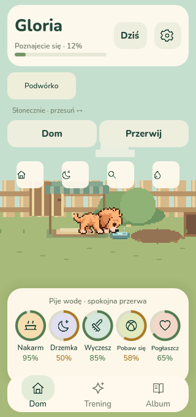
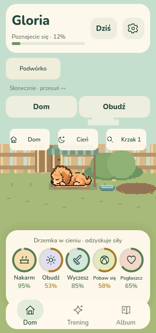

# Odpoczynek na podwórku

Rozszerzenie zainstalowane jako build 28. Nowe miejsce **Cień** ma zacienione legowisko i miskę świeżej wody. Nie dodaje pragnienia ani obowiązku uzupełniania miski. Wersja zapisu nadal **v15**. Pakiet zainstalowano i uruchomiono na iPhonie, zachowując postępy Glorii; szczegóły w [raporcie iOS](test-ios.md).

## Zachowanie Glorii

Po aporcie, chowanym, pluskaniu lub udanym torze Gloria po sześciu sekundach spokojnej bezczynności podchodzi do wody, pije i idzie poleżeć w cieniu. Może też zrobić to sama przy energii poniżej 60 lub zmęczeniu co najmniej 35. Nie przerywa aktywnej zabawy, komendy ani zaproszenia. Automatyczna przerwa ma dwuminutowy odstęp, działa w dzień, bez deszczu i przy sytości co najmniej 30.

W miejscu **Cień** gracz wybiera **Połóż się w cieniu** albo **Napij się wody**. Przycisk **Drzemka** na podwórku również prowadzi do tego legowiska. **Przerwij** kończy podejście lub picie, a **Obudź** kończy sen. Samo picie nie daje energii, więzi ani innych nagród.

Energia odnawia się dopiero po dotarciu do legowiska, według istniejącego systemu odpoczynku: 0,8 punktu na sekundę aktywnej gry pomniejszone o zwykły upływ potrzeb. Przy 85 energii pies budzi się według obecnej reguły. Wypoczęta Gloria tylko leży przez osiem sekund, bez dodatkowej nagrody. Nie ma drugiego sposobu naliczania regeneracji.

Bardzo zmęczony pies (energia poniżej 28) nadal wraca do domu. Deszcz podczas drzemki i noc przenoszą odpoczynek do domu. Przejście do Albumu, przycisk Dom i schowanie aplikacji zachowują rozpoczęty sen w domowym legowisku. Odpoczynek poza aplikacją używa istniejącej flagi `resting` i dotychczasowych ograniczeń regeneracji.

## Grafika i animacja

Nowe zadaszenie, tkane legowisko oraz miska są rysowane na pikselowej siatce podwórka w `YardRestView`. Animacja picia to złożona sekwencja istniejących klatek Glorii: opuszczenie głowy (`eat_enter`), ruch pyska przy wodzie (`eat_loop`) i podniesienie głowy (`eat_exit`). Towarzyszą jej animowane kręgi i krople w misce; pies obraca się pyskiem do wody. Nie dodano nowego arkusza sprite’ów. Całość trwa około 4,2 sekundy.

## Sprawdzenie i dane

- 29 zestawów logiki oraz 23 zestawy interfejsu zakończone bez błędów.
- Nowe zestawy: 29 sprawdzeń logiki odpoczynku i 153 sprawdzenia interfejsu, w tym 12 miejsc bez nakładających się pól dotykowych, picie, drzemka i powrót do domu przy 320 px.
- Test błędu zapisu potwierdza wycofanie rozpoczęcia drzemki bez zmiany potrzeb i postępów.
- Na odseparowanej kopii `Documents/pet.json` z archiwum po buildzie 27 odczyt i zapis zachowały dokładnie 29/29 pól Glorii. Picie nie zmieniło żadnego postępu; zwykły zapis aktualizuje czas ostatniej wizyty.
- Oryginalne archiwum i dane telefonu nie były modyfikowane. Instalację i uruchomienie buildu 28 potwierdzono; ręczna ocena picia i odpoczynku na telefonie pozostaje do wykonania.

Logika: `scripts/systems/yard_rest.gd`. Grafika: `scripts/ui/yard_rest_view.gd`. Testy: `tests/test_yard_rest.gd`, `tests/ui_yard_rest.gd`.
