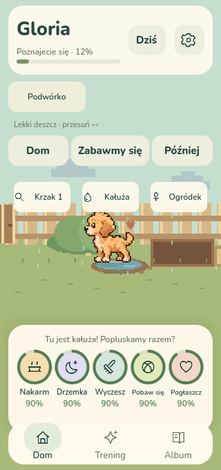
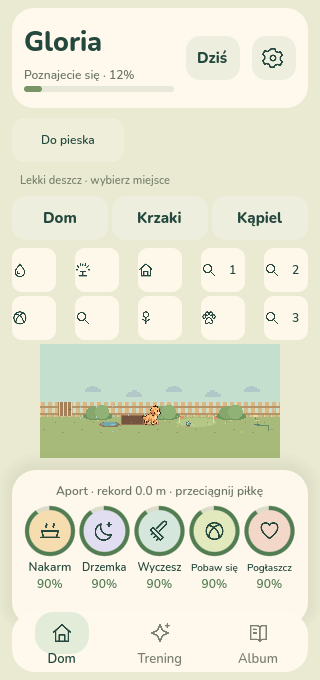

# Pogoda i zaproszenia na podwórku

Pakiet zainstalowany i uruchomiony jako build 26. Zachowuje schemat zapisu v15 i dotychczasowe postępy Glorii. Projekt znajduje się obecnie w `/Volumes/KINGSTON/YuFriend`.

## Pogoda

Lokalny kalendarz podwórka ma czterodniowy cykl: dwa dni słońca, lekki deszcz, dzień po deszczu. Początek cyklu zależy od istniejącego ziarna osobowości psa. Pogoda jest taka sama przez cały lokalny dzień oraz po ponownym uruchomieniu; nie wymaga internetu, lokalizacji ani zapisu nowego pola. Nie jest prognozą prawdziwej pogody.

- **Słońce:** suchy ślad kałuży, dostępny zraszacz.
- **Deszcz:** aktywna kałuża, zraszacz odpoczywa; dotknięcie miejsca wyjaśnia przyczynę. W tle nie pojawiają się motyl i wróbel.
- **Po deszczu:** kałuża pozostaje; można też włączyć zraszacz.

Rozpoczęta runda wody może spokojnie zakończyć się po zmianie pogody. Nadal obowiązują energia, sytość, noc, limit trzech plusków, brudzenie, otrzepywanie i kąpiel.

## Ogródek

Podczas deszczu, przy działającej grze (także w domu), roślina dostaje podlewanie przez istniejący mechanizm: wzrost w czasie rzeczywistym przez kolejne 24 godziny. Gra sprawdza to co 10 sekund, po posadzeniu oraz przy otwarciu ogródka. Deszcz nie przyznaje natychmiastowego wzrostu, więzi ani zadania przygody.

Deszcz i ręczne podlewanie współdzielą `watered_day`. Jeśli gracz już podlał roślinę tego dnia, deszcz nie wydłuża działania. Cofnięcie zegara i wielokrotne odświeżenie nie przyznają drugiego podlewania. Nieobecność nadal rozlicza istniejący czas wzrostu; pierwsza wersja nie odtwarza deszczów z dni, w których gra była zamknięta. Roślina bez wody czeka i nie więdnie.

## Zaproszenia Glorii

Obecny mechanizm inicjatywy działa też na podwórku. Po okresie bezczynności Gloria wybiera aport, szukanie smakołyka w krzakach lub wodę odpowiednią do pogody. Wybór uwzględnia ciekawość, wrażliwość, zainteresowanie piłką i szukaniem oraz wcześniejsze pluskanie. Podejście do miejsca używa istniejącej animacji chodu; przy krzakach pies węszy, przy pozostałych miejscach merda ogonem.

Zaproszenia wymagają energii ≥45, sytości ≥30, zmęczenia <75 i spokojnej chwili w dzień. Nie przerywają treningu, kąpieli, gościa, zabawy ani przejścia przez drzwi. Dom i podwórko współdzielą zapisany pięciominutowy odstęp między ofertami. Podpowiedź czeka 30 sekund widoczności; zegar odpowiedzi nie biegnie w Albumie, dialogu ani widoku całości.

Na 320 px opis pojawia się nad potrzebami, a **Zabawmy się / Później** zastępują przyciski Krzaki/Kąpiel. Dom pozostaje dostępny. Przyjęcie uruchamia istniejący tryb rzutu, chowanego lub wody; samo zaproszenie nie daje nagrody. Przyjęty aport lub szukanie dopisuje pozytywną odpowiedź do dotychczasowej pamięci tej aktywności. Pominięcie i „Później” nie zmieniają zainteresowania, potrzeb ani więzi. Wybranie innej czynności, noc, zmiana pogody na nieodpowiednią i tło aplikacji bezpiecznie usuwają propozycję.

## Grafika

Edytowalne grafiki rysowane w kodzie: pikselowe słońce, chmury, padające krople oraz mokra i sucha kałuża. Zachowana siatka trzech jednostek świata i paleta podwórka. Pogoda pozostaje za psem i elementami sterowania; ruch grafiki zatrzymuje się poza podwórkiem oraz przy utracie aktywnego widoku. Nie wymaga nowych bitmap ani klipów psa.

## Weryfikacja

`tests/test_weather.gd` sprawdza kalendarz, wodę, brak podwójnego podlewania, cofnięcie zegara, zapis, wycofanie zmian przy błędzie, samodzielną ofertę, reakcje oraz anulowanie. `tests/ui_weather.gd` sprawdza trzy pogody, rzeczywiste dojście do miejsca, przyjęcie przyciskiem, ogródek i układ 320 px. Starsze testy ręcznego podlewania i słonecznej fauny mają jawnie ustawioną pogodę.

Próba na odrębnej kopiach Glorii z buildów 24 i 25 zachowała wszystkie 29 pól przy zapisie i odczycie v15. Pominięcie zaproszenia zmieniło wyłącznie czas oferty i zapisu; nie zmieniło historii reakcji, gier ani pozostałych postępów. Oryginalnej kopii i danych iPhone’a nie modyfikowano. Ocena wizualna i dotyk na fizycznym iPhonie wymagają kolejnego buildu.

Wyniki: 27 zestawów logiki bez błędów, w tym 99 sprawdzeń pogody. Wszystkie 21 zestawów UI przechodzi po powtórzeniu testu fauny z jawną słoneczną pogodą; nowy zestaw pogody ma 19 sprawdzeń. Jednorazowy komunikat o pozostawionych zasobach przy zamykaniu testu rytmu nie wystąpił w osobnym powtórzeniu (17/17). Build 26 zainstalowano i uruchomiono na iPhonie; porównanie zapisu zachowało 27 pól dokładnie, zmieniły się wyłącznie potrzeby i czas. Szczegóły w [testach iOS](test-ios.md).
