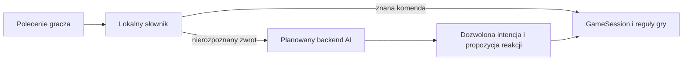

# Rozwój projektu YuFriend

[Mapa dokumentacji](README.md)

## Punkt wyjścia

Podstawowa pętla opieki, nauki i zapisu działa w lokalnym prototypie. 14 listopada 2026 wybrano pixel art i podłączono dostarczone 22 klipy / 142 klatki pakietu A+B. Następny krok to ocena gry w kilku krótkich sesjach i pierwszy eksport na telefon.

Odświeżony interfejs i dotykanie przedmiotów są wdrożone. Sprawdzono układy pionowe i szeroki panel boczny na komputerze z nowym psem. Pokój ma tło pixel art, stały świat 1440 × 360, sześć stacji, kamerę śledzącą i przesuwanie palcem. Głaskanie i trening przybliżają widok, a pies przechodzi przed i za przedmiotami. Nadal potrzebne są test na telefonie oraz ocena czytelności przy rzeczywistym skalowaniu. W dostawie pozostają drobne różnice proporcji między niezależnie narysowanymi klipami.

## Kierunek: poznawanie Glorii (15 listopada 2026)

Główny wyróżnik: pies ma własne życie i pamięć, a gracz stopniowo go poznaje. Gloria jest imieniem psa w obecnym teście iOS; systemy zawsze używają imienia z zapisu.

1. **Etap 1 — zaimplementowany:** dwa lub trzy odkrywane dziwactwa, pięć nastrojów dnia, tekstowe relacje „Kiedy Cię nie było” oraz różne powitania. [Reguły i ograniczenia](osobowosc.md#własne-życie--etap-1-15-listopada-2026). Relacje korzystają z obecnych animacji; nie dodano jeszcze graficznych śladów w pokoju.
2. **Etap 2 — zaimplementowany:** cztery rodzaje zaproszeń, pamięć przyjęcia, odłożenia i braku odpowiedzi, wpływ reakcji na kolejne propozycje oraz sekcja „Wasz rytm”. Działają rzut piłki przeciągnięciem, lina i kubki ze smakołykiem. [Reguły zabaw](mechaniki-gry.md#zabawy-dotykiem). Preferencje miejsca snu i smaku pozostają do rozbudowy; obecnie kształtuje się zainteresowanie wspólnymi aktywnościami.
3. **Nowe sceny i grafika:** krótki spacer za drzwiami, węszenie, spotkania i znaleziska; kąpiel po spacerze, brud, otrząsanie i chlapanie. Potem miska z wodą, różne smakołyki, sekwencje sztuczek i zdjęcia do Albumu z udostępnianiem.
4. **Integracje mobilne:** [widget iPhone’a](widget-ios.md) ma implementację natywną, współdzielenie stanu i powtarzalny eksport; użytkownik potwierdził imię i potrzeby Glorii na ekranie początkowym. Dodano [dobrowolne lokalne przypomnienia](powiadomienia-ios.md), których dostarczenie wymaga jeszcze próby na telefonie.

Powiadomienia mają już planowanie progów potrzeb lokalnie przy wyjściu, pierwszą osobę, maksymalnie dwa dziennie i ciszę nocną. Dalsze pomysły: głos dopasowany do charakteru, ulubiona pora wynikająca z nawyków, odkrycia i drobne zdarzenia. Bez zawstydzania za nieobecność, choroby ani śmierci psa.

Widget iOS: mały pokazuje pozę i najpilniejszą potrzebę, średni dodatkowo pięć potrzeb, nastrój i propozycje opieki, a prostokątny widget blokady imię i najpilniejszą potrzebę. Widok WidgetKit czyta niewielki stan ze znacznikiem czasu z App Group i przelicza wartości zgodnie z grą. Widgetu nie renderuje Godot. [Eksport, testy i ograniczenia](widget-ios.md). Wariant Android pozostaje do zaprojektowania.

Dalsze pomysły: pora dnia i pogoda za oknem, kolekcja prezentów ze spacerów, poziomy więzi odblokowujące zabawki, dekoracje i sztuczki oraz dorastanie wymagające kolejnego zestawu sprite’ów. Przyszłe AI może urozmaicać relacje w granicach zapisanych faktów i dozwolonych zachowań.

## Pozostałe prace i wcześniejsze priorytety

### Kolejność po audycie przypomnień — 15 listopada 2026

1. Naprawić planowanie po wieczornym wyjściu i pokryć poranny termin testami. Implementacja obejmuje teraz jedno przypomnienie następnego ranka, bez dalszego spadku potrzeb po 8 godzinach.
2. Potwierdzić na iPhonie doręczenie rzeczywistego powiadomienia, otwarcie gry i widget na ekranie początkowym.
3. Przeprowadzić tygodniową próbę z 5–10 osobami **przed dalszą rozbudową**. Zanotować powroty drugiego i siódmego dnia, powody powrotu, problemy z pierwszą sesją i elementy, które nudzą. Bez danych nie traktować samej gotowości technicznej jako potwierdzenia skuteczności pętli powrotu.
4. Według wyników ustalić zakres pierwszego uruchomienia (imię, poznanie psa, dobrowolna propozycja przypomnień), pozytywnego zaproszenia w ramach limitu dwóch, ujednolicenia głosu psa, wibracji i dymka po powrocie.
5. Dopiero potem ustalić priorytety poziomów więzi, spaceru, kąpieli i przeniesienia zabaw do pokoju. Przed wydaniem dopracować grafikę, muzykę, politykę prywatności i zakres Androida.

| Priorytet | Zakres | Warunek ukończenia |
|---|---|---|
| Gotowe | Poprawki zachowania z audytu | Spacer nie blokuje opieki, nowy cel zastępuje poprzedni, pełne potrzeby i dotyk podczas jedzenia mają reakcję |
| Gotowe | Wspólna siatka renderowania | Pokój 480 × 120 px, całkowite powiększenia, podłoga nad panelem |
| P0 | Próba finalnej grafiki i eksport na telefon | Na ustalonej siatce sprawdzić stanie, siad i chód, wspólną paletę oraz dotyk na urządzeniu |
| Gotowe | Szeroki pokój i kamera | Jeden świat na około 2–3 ekrany, sześć stacji, ręczne przesuwanie, zbliżenia i płytka głębia |
| Gotowe | Opieka w przestrzeni pokoju | Dojście do miski i legowiska, pościg za piłką, sygnalizowanie potrzeb i automatyczne budzenie |
| P1 | Balans i czytelność | W kilku sesjach gracz rozumie potrzeby, odmowę próby, moment nagrody i różnicę po nauczeniu komendy |
| P1 | Pierwszy eksport mobilny | Można zagrać na wybranym fizycznym telefonie, wznowić aplikację i zachować stan po restarcie |
| P2 | Gesty, dźwięki i wibracje | Rzut piłki gestem, lina, kubki i efekty audio są wdrożone; pozostają głaskanie przesunięciem, wibracje i weryfikacja na telefonie |
| P2 | Głębszy trening i więź | Ocena momentu nagrody, stopniowe ograniczanie pomocy, sekwencje, „zostań” i odblokowania więzi |
| P2 | Pierwsza sesja i powrót | Rytuał poznania i nadania imienia, zapowiedź nawyków, pora dnia w oknie; dopiero potem dobrowolne powiadomienia |
| P2 | Opcjonalne AI | Polecenia spoza słownika są mapowane na dozwolone działania, a brak sieci nie blokuje podstawowej gry |
| P3 | Dorastanie | Ten sam pies zmienia etap i wygląd, zachowując identyfikator, cechy, więź, wspomnienia i komendy |

Priorytety określają kolejność prac, nie terminy ani obietnicę gotowego wydania. Pierwotne szacunki programowania znajdują się w [planie implementacji](plan-implementacji.md); po podpięciu rzeczywistych materiałów można oszacować pozostały zakres ponownie.

## Integracja animacji — wykonane i dalsze poprawki

Pakiet dostarczony według [briefu](lista-spriteow-szczeniaka.md) działa w grze. Przy aktualizacji kolejnych arkuszy:

1. Sprawdzamy wspólne płótno, punkt podparcia, skalę i kierunek.
2. Importujemy tylko dostępne klipy zgodnie z [instrukcją](integracja-spriteow.md).
3. Dopasowujemy tempo przesunięcia do cyklu chodu i oglądamy przejścia między pozycjami.
4. Sprawdzamy komendy z naprowadzaniem i bez niego, czas nagrody oraz przerwanie próby.
5. Oglądamy również wejście/wyjście jedzenia, zasypianie i wybudzenie; zgodna liczba klatek nie gwarantuje zgodnych proporcji.

Jedzenie i zabawa mają 2 sekundy po dojściu do przedmiotu; animator kończy bieżące przejście przed następnym. Głaskanie reaguje na ponowne dotknięcie od razu, z ograniczeniem jedynie przyrostów. Sen zaczyna się w legowisku i kończy automatycznie przy energii 85. Przerwanie dojścia nie przyznaje efektów. Powitanie po nieobecności dobiera `LifeSystem`: przechylenie głowy lub merdanie ogonem. `bark_stand` nadal sygnalizuje głód przy misce, a `treat_take_stand` pokazuje przyjęcie nagrody na stojąco.

## Rozbudowa bez utraty postępu

Każda nowa potrzeba, komenda lub zmiana struktury danych wymaga zgodności ze starszym zapisem. Przejście z wersji 1 na 2 ma migrator, kopię wcześniejszego pliku i test odczytu starszego psa; kolejne zmiany schematu powinny dopisywać następny krok w ten sam sposób.

Warto zachować podział: `PetState` przechowuje dane, systemy obliczają efekty, sesja organizuje czynności, a widok prezentuje wynik. Nowy klip nie powinien sam przyznawać umiejętności. Rozbudowę kolejnych scen w edytorze można przeprowadzić stopniowo, zachowując te granice.

## Planowane AI

Obecna gra nie ma klienta AI ani backendu. Lokalna [osobowość i nawyki](osobowosc.md) mają już przygotowane miejsce na model: raz na dobę może on zastąpić lokalne reguły propozycją zmian cech i nawyków, którą gra sprawdza i ogranicza. Drugim możliwym zastosowaniem jest rozpoznawanie swobodnego polecenia i wybór krótkiej reakcji zgodnej z cechami psa. Decyzja o wykonaniu, postępie i nagrodzie pozostaje po stronie istniejącej logiki.

Docelowy przepływ:

Backend powinien przechowywać klucz dostawcy, kontrolować limity i zwracać ograniczony zestaw intencji. Gra potrzebuje ograniczenia czasu oczekiwania oraz powiązania odpowiedzi z aktualnym żądaniem, żeby spóźniona odpowiedź nie zmieniała nowej sytuacji. Kontekst może zawierać cechy i wybrane zapisane zdarzenia; model nie dopisuje do dziennika nieodbytych treningów.

Wybór dostawcy, modelu i hostingu jest otwarty. Obecny prototyp nie wykonuje płatnych wywołań. Przed integracją należy ustalić maksymalną liczbę zapytań na gracza i zmierzyć średni rozmiar kontekstu. Budżet techniczny będzie obejmował tokeny wejściowe i wyjściowe według wybranego cennika oraz utrzymanie backendu. Koszt będzie można oszacować po wyborze dostawcy i określeniu przewidywanego użycia.

## Dorastanie

Docelowe etapy to szczeniak, młody pies, dorosły pies i senior. Obecnie istnieje pole `life_stage`, ale nie ma automatycznej zmiany wieku, odrębnych zestawów grafik ani reguł tempa dorastania.

Przed implementacją trzeba ustalić, co wyzwala zmianę etapu: wspólnie spędzony czas, osiągnięcia czy decyzja gracza. Każdy etap potrzebuje własnych proporcji i zgodnych klipów. Zmiana grafiki zachowuje tożsamość psa i całą jego historię.

## Decyzje do podjęcia

| Decyzja | Kiedy będzie potrzebna |
|---|---|
| Zamknięta paleta pixel art | Siatka jest ustalona w [instrukcji integracji](integracja-spriteow.md); odcienie zatwierdzić na pierwszych ręcznych pozach |
| Pierwsza platforma mobilna | Przed konfiguracją eksportu i testem na urządzeniu |
| Tempo potrzeb, regeneracji i nauki | Po kilku sesjach gry z czytelnymi animacjami |
| Zakres AI i limit kosztów | Przed przygotowaniem backendu i dostępu do dostawcy |
| Zasady dorastania | Przed zamówieniem kolejnych etapów grafiki i zmianą danych |

Konta, synchronizacja, wiele zwierząt, rozbudowa domu, sterowanie głosem i monetyzacja pozostają poza obecnym prototypem. Wymagają osobnej decyzji o zakresie. Gesty zabawy, dźwięk i lokalne przypomnienia iOS są już wdrożone. Wibracje i nowe zasady treningu pozostają do wykonania. Ich kolejność warto potwierdzić po krótkich sesjach z testerami.
