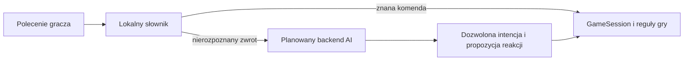

# Rozwój projektu YuFriend

[Mapa dokumentacji](README.md)

## Punkt wyjścia

Podstawowa pętla opieki, nauki i zapisu działa w lokalnym prototypie. Najbliższym krokiem jest zastąpienie referencji właściwymi klatkami szczeniaka i ocena gry w kilku krótkich sesjach. Wygląd 2D i pixel art są dostępne do porównania; wybór głównego stylu pozostaje otwarty.

## Kolejność prac

| Priorytet | Zakres | Warunek ukończenia |
|---|---|---|
| P0 | Integracja pakietu A — 8 klipów ruchu i treningu | Stanie, chód, siadanie, wstawanie, radość i łapa mają zgodne pozycje; nagroda czeka na wykonanie |
| P1 | Pakiet B — 14 klipów opieki i reakcji | Pies poprawnie je, kładzie się, śpi, budzi i reaguje; miska oraz fazy czynności pasują do grafiki |
| P1 | Balans i czytelność | W kilku sesjach gracz rozumie potrzeby, odmowę próby, moment nagrody i różnicę po nauczeniu komendy |
| P1 | Pierwszy eksport mobilny | Można zagrać na wybranym fizycznym telefonie, wznowić aplikację i zachować stan po restarcie |
| P2 | Dźwięki i przedmioty | Szczeknięcie i efekty mają właściwy moment; przedmioty pasują do ruchów i kierunku postaci |
| P2 | Rozszerzone zachowania i komendy | Nowe czynności mają reguły, grafikę, zapis postępu i testy bez psucia wcześniejszych danych |
| P2 | Opcjonalne AI | Polecenia spoza słownika są mapowane na dozwolone działania, a brak sieci nie blokuje podstawowej gry |
| P3 | Dorastanie | Ten sam pies zmienia etap i wygląd, zachowując identyfikator, cechy, więź, wspomnienia i komendy |

Priorytety określają kolejność prac, nie terminy ani obietnicę gotowego wydania. Pierwotne szacunki programowania znajdują się w [planie implementacji](plan-implementacji.md); po podpięciu rzeczywistych materiałów można oszacować pozostały zakres ponownie.

## Pierwsza integracja animacji

Użytkownik przygotowuje sprite’y według [briefu](lista-spriteow-szczeniaka.md). Po otrzymaniu pierwszej partii:

1. Sprawdzamy wspólne płótno, punkt podparcia, skalę i kierunek.
2. Importujemy tylko dostępne klipy zgodnie z [instrukcją](integracja-spriteow.md).
3. Dopasowujemy tempo przesunięcia do cyklu chodu i oglądamy przejścia między pozycjami.
4. Sprawdzamy komendy z naprowadzaniem i bez niego, czas nagrody oraz przerwanie próby.
5. Dopiero po zgodności pakietu A rozszerzamy opiekę i reakcje.

Obecnie czas zwykłej opieki wynosi 2 sekundy i jest niezależny od ukończenia konkretnej animacji. Przy pakiecie B trzeba uzgodnić ten czas lub powiązać go z fazami ruchu. `bark_stand` i `treat_take_stand` są rozpoznawane przez animator, ale nie mają jeszcze osobnej sytuacji rozgrywki.

## Rozbudowa bez utraty postępu

Każda nowa potrzeba, komenda lub zmiana struktury danych wymaga zgodności ze starszym zapisem. Wersja 1 nie ma mechanizmu migracji. Pierwsza zmiana schematu powinna więc obejmować migrator, kopię wcześniejszego pliku i test odczytu już istniejącego psa.

Warto zachować podział: `PetState` przechowuje dane, systemy obliczają efekty, sesja organizuje czynności, a widok prezentuje wynik. Nowy klip nie powinien sam przyznawać umiejętności. Rozbudowę kolejnych scen w edytorze można przeprowadzić stopniowo, zachowując te granice.

## Planowane AI

Obecna gra nie ma klienta AI ani backendu. Pierwszym możliwym zastosowaniem jest rozpoznawanie swobodnego polecenia i wybór krótkiej reakcji zgodnej z cechami psa. Decyzja o wykonaniu, postępie i nagrodzie pozostaje po stronie istniejącej logiki.

Docelowy przepływ:

Backend powinien przechowywać klucz dostawcy, kontrolować limity i zwracać ograniczony zestaw intencji. Gra potrzebuje ograniczenia czasu oczekiwania oraz powiązania odpowiedzi z aktualnym żądaniem, żeby spóźniona odpowiedź nie zmieniała nowej sytuacji. Kontekst może zawierać cechy i wybrane zapisane zdarzenia; model nie dopisuje do dziennika nieodbytych treningów.

Wybór dostawcy, modelu i hostingu jest otwarty. Obecny prototyp nie wykonuje płatnych wywołań. Przed integracją należy ustalić maksymalną liczbę zapytań na gracza i zmierzyć średni rozmiar kontekstu. Budżet techniczny będzie obejmował tokeny wejściowe i wyjściowe według wybranego cennika oraz utrzymanie backendu. Koszt będzie można oszacować po wyborze dostawcy i określeniu przewidywanego użycia.

## Dorastanie

Docelowe etapy to szczeniak, młody pies, dorosły pies i senior. Obecnie istnieje pole `life_stage`, ale nie ma automatycznej zmiany wieku, odrębnych zestawów grafik ani reguł tempa dorastania.

Przed implementacją trzeba ustalić, co wyzwala zmianę etapu: wspólnie spędzony czas, osiągnięcia czy decyzja gracza. Każdy etap potrzebuje własnych proporcji i zgodnych klipów. Zmiana grafiki zachowuje tożsamość psa i całą jego historię.

## Decyzje do podjęcia

| Decyzja | Kiedy będzie potrzebna |
|---|---|
| Główny styl: prosta ilustracja czy pixel art | Po obejrzeniu pierwszych klipów w docelowym rozmiarze |
| Docelowa siatka i paleta pixel art | Przed produkcją pełnego zestawu w tym stylu |
| Pierwsza platforma mobilna | Przed konfiguracją eksportu i testem na urządzeniu |
| Tempo potrzeb, regeneracji i nauki | Po kilku sesjach gry z czytelnymi animacjami |
| Zakres AI i limit kosztów | Przed przygotowaniem backendu i dostępu do dostawcy |
| Zasady dorastania | Przed zamówieniem kolejnych etapów grafiki i zmianą danych |

Konta, synchronizacja, wiele zwierząt, rozbudowa domu, sterowanie głosem i monetyzacja pozostają poza obecnym prototypem. Wymagają osobnej decyzji o zakresie.
