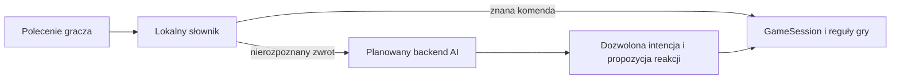

# Rozwój projektu YuFriend

[Mapa dokumentacji](README.md)

## Aktualny plan po audycie i feedbacku — 17 listopada 2026

Decyzja użytkownika z 17 listopada 2026: rozwijamy wyjście na potrzebę i ogródek równolegle z testami, bez czekania na koniec tygodnia. Poniższa pierwotna kolejność pozostaje historią planu; testy z ludźmi nadal są otwarte i nie są warunkiem wdrożenia tych dwóch funkcji.

### Plan wykonawczy — zatwierdzona kolejność wdrażania

Polecenie rozpoczęcia wdrożenia: 17 listopada 2026. Realizujemy kolejno:

1. Ochrona zapisów i regresja odzyskiwania; następnie forma, dobór listy dnia i komunikaty treningu.
2. Trwały dzienny limit premii aportu oraz porównanie całkowitego tempa więzi z treningiem.
3. Zmęczenie na podwórku, odblokowania, Album, balans pielęgnacji i układ 320 px.
4. Porządek w dokumentacji i sprawdzane commity, zamrożenie schematu, świeża kopia Documents, kompilacja oraz aktualizacja iPhone’a z porównaniem danych.
5. Rzeczywisty widget i przypomnienie, następnie siedem dni z 5–10 testerami. Ten etap wymaga uczestników i upływu czasu; nie można zastąpić go testami automatycznymi.
6. Po wynikach wybór jednego rozszerzenia z etapu D; przed ogródkiem/kopaniem wydzielenie systemów podwórka i kąpieli. Checklistę wydania sklepowego realizujemy po ustaleniu zakresu produktu.

Każdy pakiet kończy się testami adekwatnymi do zmian. Aktualny wyjątek zatwierdzony przez użytkownika: wyjście na potrzebę i ogródek wdrażamy teraz. Pozostałe rozszerzenia nadal wymagają wyboru zakresu.

**Pakiety stabilizacyjne i instalacja zakończone:** kod, grafiki i regresje są w commicie `3ea71cc`. Build 17 zainstalowano i uruchomiono na iPhonie jako aktualizację tej samej aplikacji. Świeża kopia Glorii v8 przeszła do v11; porównanie po uruchomieniu potwierdziło tożsamość, sztuczki, więź, nawyki, zdjęcia, dekoracje i osiągnięcia. Oryginał v8 zachowano również w archiwum z sumą zawartości, ponieważ istniała już inna kopia `.v8`.

Przechodzi 17 zestawów logiki i 11 UI, widget oraz sprawdzenia przypomnień. Gotowe są forma i dobór treningu dnia, limit więzi aportu, powrót zmęczonego psa, usuwanie zdjęć z potwierdzeniem, warunki i koszt kąpieli oraz układ 320 px. Usunięcie zdjęcia zwalnia miejsce w Albumie, ale zachowuje PNG dla starszych kopii zapisu. Osobne pole błota i zakładki Albumu pozostają do oceny po teście.

**Następny etap:** obserwacja widgetu i rzeczywistego doręczenia przypomnienia w buildzie 17, następnie siedem dni z 5–10 osobami. Automatyczne testy i instalacja nie zastępują tych obserwacji. Szczegóły i kopie: [testy iOS](test-ios.md).

### Stan potwierdzony i granice weryfikacji

- Wdrożone: trwałe opanowanie sztuczek, osobna forma i trening dnia z serią oraz premią +2 więzi; spadek formy 10 za pominięty pełny dzień, minimum 50, odzyskanie 25 po nagrodzonej próbie; ochrona przed powtórzeniem dziennej premii po cofnięciu zegara.
- Naprawione: `test_life` wykonuje 46 sprawdzeń, nocne wejście na podwórko jest blokowane, a bezczynny pies wraca po 30 sekundach; działa limit dojścia, właściwy tekst spaceru i zamknięcie podwórka po przejściu w tło. Zakaz dotyczy **nocnej fazy indywidualnego rytmu**, a nie całego wieczoru. Aktywna zabawa może się zakończyć; chowany ma limit 120 sekund.
- Wdrożone: stałe miejsca, aport z zamachem, rekordem i premią chwytu, dwa warianty chowanego, kąpiel, zdjęcia i dekoracje.
- Audyt z 17 listopada: 14 zestawów logiki i 11 interfejsu przechodzi; m.in. rytm 135, forma 29, aport 30, chowany 62. Widget 1526 sprawdzeń, przypomnienia 1085 (1067 planisty + 18 kontrolera). To nie zastępuje próby doręczenia powiadomienia i odświeżania widgetu na urządzeniu.
- Aktualny stan telefonu i kodu: build **17**, zapis **v11**, gra odczytuje v1–v11, widget v4–v11. Wpisy o v9/v10 opisują etapy pośrednie.
- Błędy migracji niepełnych zapisów, doboru listy dnia, formy zablokowanych sztuczek i komunikatów mają poprawki oraz regresje.

### Etap A — stabilizacja przed buildem dla testerów

| Priorytet | Zmiana | Warunek akceptacji |
|---|---|---|
| A1 | Walidacja starszych zapisów według ich wersji; brak wymaganego pola oznacza uszkodzenie. Archiwizowanie również nowszej zawartości `.vN` tego samego psa. | V9 bez `practice` odzyskuje poprawny `.bak`, zachowując serię; kolejne zapisy nie niszczą poprawnej kopii. Ponowna migracja po rollbacku zabezpiecza najświeższy stan zgodny ze starym buildem. |
| A2 | Forma spada **tylko w sztuczkach opanowanych na 100%**. Główny efekt słabej formy przenosimy na szansę wykonania bez podpowiedzi, z reakcją „Hmm, jak to szło?”. Okno nagrody pozostaje czytelne i stałe; poprawne ćwiczenie z podpowiedzią daje bezpieczną drogę odświeżenia. | Zablokowana i jeszcze uczona sztuczka nie traci formy. Kontrolowane próby pokazują niższą szansę bez podpowiedzi przy niższej formie; gest z podpowiedzią nadal działa. Opanowanie i odblokowania pozostają trwałe. |
| A3 | Lista „Na dziś” wybiera sztuczki wymagające odświeżenia, uwzględniając najdłuższą przerwę. Komunikat pokazuje przyrost formy i zaliczenie dnia zamiast „+0 Siad”. | Symulacja 7 i 28 dni, dziewięć opanowanych sztuczek i wykonywanie całej proponowanej listy nie prowadzi do stałego spadku części form do 50%. Docelowy zdrowy przedział ustalić w balansie; nie wymagać codziennego odtwarzania wszystkich dziewięciu komend. |
| A4 | Premia więzi za precyzyjny chwyt tylko za **pierwsze trzy celne złapania danego dnia**. Kolejne rzuty nadal dają zabawę i wynik. Sprawdzić także bazowe +0,35 więzi za aport i całkowite tempo zdobywania więzi. | Restart, wielokrotny dotyk i cofnięcie zegara nie odnawiają limitu. Czwarty chwyt nie daje premii +1. Osobno test dziennego limitu i rzeczywistych 30 sekund przerwy; raport całkowitej więzi po 10 minutach, porównany z treningiem. |
| A5 | Poprawić słonecznik po dowolnym pierwszym znalezisku, komunikat niepełnej kolekcji oraz powrót zmęczonego psa z podwórka. | Każdy z trzech możliwych pierwszych skarbów spełnia opis odblokowania; duplikat nie udaje pełnej kolekcji; niski poziom energii prowadzi do odpoczynku. |
| A6 | Domknąć 320 px: oddzielić podpisy „Pobaw się” i „Pogłaszcz”, poprawić wykorzystanie przestrzeni w podglądzie całego podwórka. | Zrzuty i dotyk na wąskim ekranie: brak kolizji podpisów, czytelne miejsca, widoczny pies i ogon; kontrolki zachowują wygodne pola dotyku. |
| A7 | Album: usuwanie zdjęć z potwierdzeniem lub możliwością wycofania, dostęp do wspomnień niezależny od długiej listy zdjęć. Kąpiel: odróżnić ją od szybkiego czesania, ustalić warunki rozpoczęcia i koszt; oddzielić błoto z podwórka od pasywnego spadku czystości. | Po zapełnieniu 24 miejsc da się świadomie zwolnić miejsce bez utraty innych zdjęć. Kąpiel nie jest bezwarunkowym resetem dostępnej pielęgnacji; jej reguły są zrozumiałe i sprawdzone z głodnym/zmęczonym psem. |

Szacunek **około +27 więzi w 10 minut aportu** pochodzi z wartości nagród i kosztu energii, a nie z przeprowadzonej dziesięciominutowej próby. Zegar nagród korzysta z czasu rzeczywistego, więc samo przyspieszenie `_process(delta)` tego nie mierzy. W testach balansu potrzebny jest kontrolowany zegar nagród albo prawdziwy przebieg czasu. Po limicie trzech chwytów pozostaje bazowa nagroda za zabawę — trzeba ocenić sumę, nie tylko premię.

### Etap B — porządek w repozytorium i wydanie testowe

1. Przed porządkowaniem zabezpieczyć bieżące niezacommitowane źródła, nowe grafiki i opisy ich pochodzenia. Duży zestaw zmian rozdzielić po zależnościach; nie usuwać plików `-v1` ani notatek generowania tylko z powodu nazwy. To wersjonowane materiały źródłowe.
2. Przygotować tematyczne commity: **sztuczki i forma → podwórko (w razie potrzeby osobno aport/chowany) → kąpiel → zdjęcia i dekoracje**, plus poprawki stabilizacyjne i dokumentacja. Wspólne zmiany zapisu oraz UI dzielić na sprawdzane fragmenty; każdy commit powinien się uruchamiać i przechodzić odpowiednie testy. Nie robić `git add .` ani pozornego podziału po samych nazwach plików. Jeśli rozdzielenie istniejących zależności wymagałoby ryzykownego przepisywania historii, najpierw zachować kompletny, zweryfikowany punkt odniesienia.
3. Ujednolicić aktualny opis gry, numer buildu i schematu w README, mechanikach, danych i dokumentacji iOS. Historię etapów zachować jako historię. Dążyć do **jednego docelowego podniesienia schematu na wydanie**, po zebraniu zmian danych; nie usuwać obsługi istniejących formatów ani nie obniżać numeru wstecz.
4. Zamrozić docelowy schemat po implementacji trwałego licznika premii aportu. Docelowy schemat buildu 17 to v11; wersja i migracja muszą odpowiadać rzeczywistej zgodności danych — numeru nie utrzymywać sztucznie, jeśli naruszałoby to istniejące zapisy.
5. Bezpośrednio przed instalacją pobrać **świeżą kopię całego Documents Glorii**, w tym zdjęć, ustawień i danych przypomnień. Na roboczej kopii sprawdzić **v8 → v10** (lub ostateczny schemat, jeśli zmieni się w etapie A). Porównać wszystkie istniejące pola, pliki zdjęć i kopie wersjonowane; sprawdzić restart i ponowny zapis.
6. Nadać nowy numer buildu, zachować identyfikator aplikacji i zespół podpisujący, instalować jako aktualizację bez odinstalowania. Eksport i DerivedData umieścić na dysku z miejscem; audyt wskazał niemal pełny SSD projektu. Po uruchomieniu ponownie odczytać dane i porównać z kopią sprzed instalacji.
7. Na fizycznym iPhonie potwierdzić widget, odświeżenie po opiece i upływie czasu, rzeczywiste doręczenie przypomnienia, otwarcie gry z powiadomienia, zachowanie limitów i wyłączenia przypomnień. Sam poprawny test Swift nie zamyka tych punktów.

Wyodrębnienie podwórka i kąpieli z `GameSession` oraz paneli z `main.gd` pozostaje zadaniem technicznym **przed ogródkiem i kopaniem**. W etapie stabilizacji ograniczyć refaktor do niezbędnych zmian i zachować zachowanie gry; duża przebudowa nie powinna opóźniać testu obecnego pomysłu. Orientacyjny stan audytu: około 1200 i 1500 wierszy odpowiednio.

### Etap C — siedem dni testów z 5–10 osobami

Gotowy [protokół, dziennik i formularz raportu](test-tygodniowy.md).

Start dopiero po przejściu etapów A–B. Jeden ustalony build i zapisane parametry balansu; w trakcie poprawiać błędy blokujące, odnotowując wersję. Nie dokładać ogródka, kopania ani nowych potrzeb. Mała próba służy rozpoznaniu zachowań i problemów, nie statystycznemu potwierdzeniu retencji.

- **Dzień 1:** obserwacja pierwszej sesji bez tłumaczenia przycisków. Czy gracz rozumie potrzeby, kończy jedną sztuczkę, trafia na podwórko i odkrywa zabawy w krzakach? Zapisać miejsca wymagające pomocy.
- **Dni 2–6:** swobodne używanie. Zanotować rzeczywiste powroty, powód wizyty, wybraną aktywność, moment zakończenia oraz odczucia wobec formy, limitów i kąpieli. Oddzielić wizyty spontaniczne, po przypomnieniu gry i wywołane kontaktem badacza; nie przypominać codziennie o graniu i nie traktować tego jako naturalnego powrotu.
- **Dzień 7:** krótka rozmowa: co gracz pamięta o swoim psie, do czego wracał, co nudziło, czego oczekiwał następnego dnia i czy chce kontynuować. Obejrzeć końcowy stan bez resetowania psa.
- Raport podaje liczby osób, które wróciły w D2 i D7, z mianownikiem oraz powodami nieobecności; czas sesji, ulubione/porzucane zabawy i zmiany więzi. Zbieranie obserwacji może być ręczne, bez dodawania zewnętrznej telemetrii.
- Warunek przejścia: zakończona obserwacja tygodnia, opis wyników i konkretna decyzja o następnej funkcji; brak utraty danych lub blokujących błędów. Jeśli gracze nie rozumieją podstaw lub nie znajdują przyjemności w istniejących zabawach, wrócić do etapu A i poprawić je przed rozszerzaniem gry.

### Etap D — rozbudowa zależna od wyników

| Obserwacja z testu | Następny zakres | Ograniczenie pierwszej wersji |
|---|---|---|
| Gracze lubią opiekę, lecz nie mają codziennego powodu do wizyty | Dobrowolne wyjście na potrzebę i/lub ogródek | Wyjście jako pozytywny rytuał bez kary; ogródek: jedna grządka, trzy rośliny, realny czas, brak podlania zatrzymuje wzrost zamiast niszczyć roślinę. Wybrać pierwszy z tych pomysłów na podstawie rozmów. |
| Więź szybko dochodzi do limitu lub wydaje się bez znaczenia | Poziomy więzi i odblokowania | Czytelne progi, kilka dekoracji/zabaw lub wspólnych rytuałów. Zachować zdobytą więź, bez resetu i dodatkowej waluty. |
| Gracze najczęściej wybierają eksplorację i kompletowanie | Kopanie z kolekcją | Najpierw animacja kopania, jedna stacja, około 12 przedmiotów, katalog braków i sens duplikatów. |
| Gracze lubią trening, ale nie używają sztuczek w świecie | Sztuczki w zabawach | Przyjdź przy aporcie, Zostań przy chowaniu; ta sama forma i lista dnia, bez oddzielnego postępu. |

Goście, pory roku, tor przeszkód i dalsze gesty są późniejszymi opcjami. AI, choroby i dorastanie pozostają odłożone. Kierunek produktu: „krótkie wspólne chwile zmieniają mojego psa, jego dom i ogród”. Nie dodajemy obowiązków wyłącznie po to, by wymusić codzienną wizytę.

### Przed wydaniem sklepowym

- Pierwsze uruchomienie z nadaniem imienia i krótkim poznaniem psa. Aktualizacja istniejącego zapisu pomija ten krok i nie zmienia imienia Glorii.
- Wibracje przy chwycie i udanej sztuczce, z możliwością wyłączenia; spokojniejsza alternatywa dla precyzyjnego dotyku.
- Polityka prywatności zgodna z rzeczywistym przepływem danych, uprawnieniami i ewentualną analityką; weryfikacja treści na etapie wydania.
- Docelowa grafika i muzyka: spójność klipów, czytelność na telefonie, prawa i pochodzenie materiałów, zachowane źródła.
- Android jako osobny etap eksportu, dotyku, cyklu życia, trwałości zapisu i powiadomień. Nie zakładać automatycznej zgodności po testach iOS; zakres ewentualnego widgetu Android określić osobno.

## Archiwum wcześniejszych decyzji — 10–15 listopada 2026

Poniższe materiały zachowują historię projektu. Ich dawne priorytety, liczby animacji, informacje o pierwszym eksporcie i planowane już dziś wdrożone funkcje **nie zastępują aktualnego planu powyżej**.

### Punkt wyjścia

Podstawowa pętla opieki, nauki i zapisu działa w lokalnym prototypie. 14 listopada 2026 wybrano pixel art i podłączono dostarczone 22 klipy / 142 klatki pakietu A+B. Następny krok to ocena gry w kilku krótkich sesjach i pierwszy eksport na telefon.

Odświeżony interfejs i dotykanie przedmiotów są wdrożone. Sprawdzono układy pionowe i szeroki panel boczny na komputerze z nowym psem. Pokój ma tło pixel art, stały świat 1440 × 360, sześć stacji, kamerę śledzącą i przesuwanie palcem. Głaskanie i trening przybliżają widok, a pies przechodzi przed i za przedmiotami. Nadal potrzebne są test na telefonie oraz ocena czytelności przy rzeczywistym skalowaniu. W dostawie pozostają drobne różnice proporcji między niezależnie narysowanymi klipami.

### Kierunek: poznawanie Glorii (15 listopada 2026)

Główny wyróżnik: pies ma własne życie i pamięć, a gracz stopniowo go poznaje. Gloria jest imieniem psa w obecnym teście iOS; systemy zawsze używają imienia z zapisu.

1. **Etap 1 — zaimplementowany:** dwa lub trzy odkrywane dziwactwa, pięć nastrojów dnia, tekstowe relacje „Kiedy Cię nie było” oraz różne powitania. [Reguły i ograniczenia](osobowosc.md#własne-życie--etap-1-15-listopada-2026). Relacje korzystają z obecnych animacji; nie dodano jeszcze graficznych śladów w pokoju.
2. **Etap 2 — zaimplementowany:** cztery rodzaje zaproszeń, pamięć przyjęcia, odłożenia i braku odpowiedzi, wpływ reakcji na kolejne propozycje oraz sekcja „Wasz rytm”. Działają rzut piłki przeciągnięciem, lina i kubki ze smakołykiem. [Reguły zabaw](mechaniki-gry.md#zabawy-dotykiem). Preferencje miejsca snu i smaku pozostają do rozbudowy; obecnie kształtuje się zainteresowanie wspólnymi aktywnościami.
3. **Nowe sceny i grafika:** krótki spacer za drzwiami, węszenie, spotkania i znaleziska; kąpiel po spacerze, brud, otrząsanie i chlapanie. Potem miska z wodą, różne smakołyki, sekwencje sztuczek i zdjęcia do Albumu z udostępnianiem.
4. **Integracje mobilne:** [widget iPhone’a](widget-ios.md) ma implementację natywną, współdzielenie stanu i powtarzalny eksport; użytkownik potwierdził imię i potrzeby Glorii na ekranie początkowym. Dodano [dobrowolne lokalne przypomnienia](powiadomienia-ios.md), których dostarczenie wymaga jeszcze próby na telefonie.

Powiadomienia mają już planowanie progów potrzeb lokalnie przy wyjściu, pierwszą osobę, maksymalnie dwa dziennie i ciszę nocną. Dalsze pomysły: głos dopasowany do charakteru, ulubiona pora wynikająca z nawyków, odkrycia i drobne zdarzenia. Bez zawstydzania za nieobecność, choroby ani śmierci psa.

Widget iOS: mały pokazuje pozę i najpilniejszą potrzebę, średni dodatkowo pięć potrzeb, nastrój i propozycje opieki, a prostokątny widget blokady imię i najpilniejszą potrzebę. Widok WidgetKit czyta niewielki stan ze znacznikiem czasu z App Group i przelicza wartości zgodnie z grą. Widgetu nie renderuje Godot. [Eksport, testy i ograniczenia](widget-ios.md). Wariant Android pozostaje do zaprojektowania.

Dalsze pomysły: pora dnia i pogoda za oknem, kolekcja prezentów ze spacerów, poziomy więzi odblokowujące zabawki, dekoracje i sztuczki oraz dorastanie wymagające kolejnego zestawu sprite’ów. Przyszłe AI może urozmaicać relacje w granicach zapisanych faktów i dozwolonych zachowań.

### Pozostałe prace i wcześniejsze priorytety

#### Kolejność po audycie przypomnień — 15 listopada 2026

1. Naprawić planowanie po wieczornym wyjściu i pokryć poranny termin testami. Implementacja obejmuje teraz jedno przypomnienie następnego ranka, bez dalszego spadku potrzeb po 8 godzinach.
2. Potwierdzić na iPhonie doręczenie rzeczywistego powiadomienia, otwarcie gry i widget na ekranie początkowym.
3. Przeprowadzić tygodniową próbę z 5–10 osobami **przed dalszą rozbudową**. Zanotować powroty drugiego i siódmego dnia, powody powrotu, problemy z pierwszą sesją i elementy, które nudzą. Bez danych nie traktować samej gotowości technicznej jako potwierdzenia skuteczności pętli powrotu.
4. Według wyników ustalić zakres pierwszego uruchomienia (imię, poznanie psa, dobrowolna propozycja przypomnień), pozytywnego zaproszenia w ramach limitu dwóch, ujednolicenia głosu psa, wibracji i dymka po powrocie.
5. Dopiero potem ustalić priorytety poziomów więzi, spaceru, kąpieli i przeniesienia zabaw do pokoju. Przed wydaniem dopracować grafikę, muzykę, politykę prywatności i zakres Androida.

| Priorytet | Zakres | Warunek ukończenia |
|---|---|---|
| Gotowe | Poprawki zachowania z audytu | Spacer nie blokuje opieki, nowy cel zastępuje poprzedni, pełne potrzeby i dotyk podczas jedzenia mają reakcję |
| Gotowe | Wspólna siatka renderowania | Pokój 480 × 120 px, całkowite powiększenia, podłoga nad panelem |
| P0 | Próba finalnej grafiki i eksport na telefon | Na ustalonej siatce sprawdzić stanie, siad i chód, wspólną paletę oraz dotyk na urządzeniu |
| Gotowe | Szeroki pokój i kamera | Jeden świat na około 2–3 ekrany, sześć stacji, ręczne przesuwanie, zbliżenia i płytka głębia |
| Gotowe | Opieka w przestrzeni pokoju | Dojście do miski i legowiska, pościg za piłką, sygnalizowanie potrzeb i automatyczne budzenie |
| P1 | Balans i czytelność | W kilku sesjach gracz rozumie potrzeby, odmowę próby, moment nagrody i różnicę po nauczeniu komendy |
| P1 | Pierwszy eksport mobilny | Można zagrać na wybranym fizycznym telefonie, wznowić aplikację i zachować stan po restarcie |
| P2 | Gesty, dźwięki i wibracje | Rzut piłki gestem, lina, kubki i efekty audio są wdrożone; pozostają głaskanie przesunięciem, wibracje i weryfikacja na telefonie |
| P2 | Głębszy trening i więź | Ocena momentu nagrody, stopniowe ograniczanie pomocy, sekwencje, „zostań” i odblokowania więzi |
| P2 | Pierwsza sesja i powrót | Rytuał poznania i nadania imienia, zapowiedź nawyków, pora dnia w oknie; dopiero potem dobrowolne powiadomienia |
| P2 | Opcjonalne AI | Polecenia spoza słownika są mapowane na dozwolone działania, a brak sieci nie blokuje podstawowej gry |
| P3 | Dorastanie | Ten sam pies zmienia etap i wygląd, zachowując identyfikator, cechy, więź, wspomnienia i komendy |

Priorytety określają kolejność prac, nie terminy ani obietnicę gotowego wydania. Pierwotne szacunki programowania znajdują się w [planie implementacji](plan-implementacji.md); po podpięciu rzeczywistych materiałów można oszacować pozostały zakres ponownie.

### Integracja animacji — wykonane i dalsze poprawki

Pakiet dostarczony według [briefu](lista-spriteow-szczeniaka.md) działa w grze. Przy aktualizacji kolejnych arkuszy:

1. Sprawdzamy wspólne płótno, punkt podparcia, skalę i kierunek.
2. Importujemy tylko dostępne klipy zgodnie z [instrukcją](integracja-spriteow.md).
3. Dopasowujemy tempo przesunięcia do cyklu chodu i oglądamy przejścia między pozycjami.
4. Sprawdzamy komendy z naprowadzaniem i bez niego, czas nagrody oraz przerwanie próby.
5. Oglądamy również wejście/wyjście jedzenia, zasypianie i wybudzenie; zgodna liczba klatek nie gwarantuje zgodnych proporcji.

Jedzenie i zabawa mają 2 sekundy po dojściu do przedmiotu; animator kończy bieżące przejście przed następnym. Głaskanie reaguje na ponowne dotknięcie od razu, z ograniczeniem jedynie przyrostów. Sen zaczyna się w legowisku i kończy automatycznie przy energii 85. Przerwanie dojścia nie przyznaje efektów. Powitanie po nieobecności dobiera `LifeSystem`: przechylenie głowy lub merdanie ogonem. `bark_stand` nadal sygnalizuje głód przy misce, a `treat_take_stand` pokazuje przyjęcie nagrody na stojąco.

### Rozbudowa bez utraty postępu

Każda nowa potrzeba, komenda lub zmiana struktury danych wymaga zgodności ze starszym zapisem. Przejście z wersji 1 na 2 ma migrator, kopię wcześniejszego pliku i test odczytu starszego psa; kolejne zmiany schematu powinny dopisywać następny krok w ten sam sposób.

Warto zachować podział: `PetState` przechowuje dane, systemy obliczają efekty, sesja organizuje czynności, a widok prezentuje wynik. Nowy klip nie powinien sam przyznawać umiejętności. Rozbudowę kolejnych scen w edytorze można przeprowadzić stopniowo, zachowując te granice.

### Planowane AI

Obecna gra nie ma klienta AI ani backendu. Lokalna [osobowość i nawyki](osobowosc.md) mają już przygotowane miejsce na model: raz na dobę może on zastąpić lokalne reguły propozycją zmian cech i nawyków, którą gra sprawdza i ogranicza. Drugim możliwym zastosowaniem jest rozpoznawanie swobodnego polecenia i wybór krótkiej reakcji zgodnej z cechami psa. Decyzja o wykonaniu, postępie i nagrodzie pozostaje po stronie istniejącej logiki.

Docelowy przepływ:

Backend powinien przechowywać klucz dostawcy, kontrolować limity i zwracać ograniczony zestaw intencji. Gra potrzebuje ograniczenia czasu oczekiwania oraz powiązania odpowiedzi z aktualnym żądaniem, żeby spóźniona odpowiedź nie zmieniała nowej sytuacji. Kontekst może zawierać cechy i wybrane zapisane zdarzenia; model nie dopisuje do dziennika nieodbytych treningów.

Wybór dostawcy, modelu i hostingu jest otwarty. Obecny prototyp nie wykonuje płatnych wywołań. Przed integracją należy ustalić maksymalną liczbę zapytań na gracza i zmierzyć średni rozmiar kontekstu. Budżet techniczny będzie obejmował tokeny wejściowe i wyjściowe według wybranego cennika oraz utrzymanie backendu. Koszt będzie można oszacować po wyborze dostawcy i określeniu przewidywanego użycia.

### Dorastanie

Docelowe etapy to szczeniak, młody pies, dorosły pies i senior. Obecnie istnieje pole `life_stage`, ale nie ma automatycznej zmiany wieku, odrębnych zestawów grafik ani reguł tempa dorastania.

Przed implementacją trzeba ustalić, co wyzwala zmianę etapu: wspólnie spędzony czas, osiągnięcia czy decyzja gracza. Każdy etap potrzebuje własnych proporcji i zgodnych klipów. Zmiana grafiki zachowuje tożsamość psa i całą jego historię.

### Decyzje do podjęcia

| Decyzja | Kiedy będzie potrzebna |
|---|---|
| Zamknięta paleta pixel art | Siatka jest ustalona w [instrukcji integracji](integracja-spriteow.md); odcienie zatwierdzić na pierwszych ręcznych pozach |
| Pierwsza platforma mobilna | Przed konfiguracją eksportu i testem na urządzeniu |
| Tempo potrzeb, regeneracji i nauki | Po kilku sesjach gry z czytelnymi animacjami |
| Zakres AI i limit kosztów | Przed przygotowaniem backendu i dostępu do dostawcy |
| Zasady dorastania | Przed zamówieniem kolejnych etapów grafiki i zmianą danych |

Konta, synchronizacja, wiele zwierząt, rozbudowa domu, sterowanie głosem i monetyzacja pozostają poza obecnym prototypem. Wymagają osobnej decyzji o zakresie. Gesty zabawy, dźwięk i lokalne przypomnienia iOS są już wdrożone. Wibracje i nowe zasady treningu pozostają do wykonania. Ich kolejność warto potwierdzić po krótkich sesjach z testerami.
