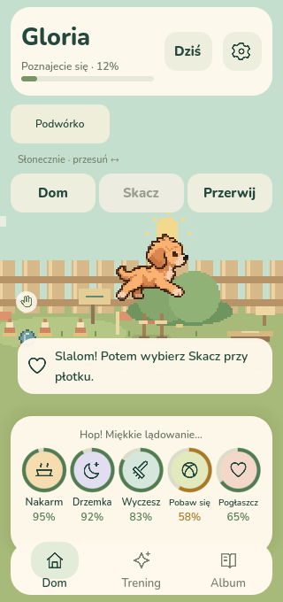
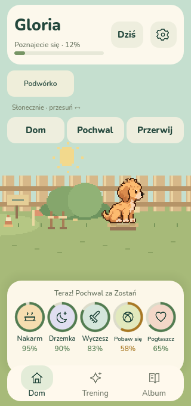

# Mały tor przeszkód

Pakiet zainstalowany i uruchomiony jako build 27. Nowe stałe miejsce **Tor** otwiera krótką rundę: slalom → płotek → podest. Schemat zapisu pozostaje v15. Instalacja zachowała dotychczasowe postępy Glorii; szczegóły w [testach iOS](test-ios.md).

## Rozgrywka

Gloria podbiega do trzech pachołków i omija je po naprzemiennych punktach. Kamera przybliża psa i podąża za nim. Przy płotku czeka na **Skacz**. Po lądowaniu podchodzi na podest, gdzie gracz wybiera **Zostań** (próba z gestem), czeka na wykonanie i dotyka **Pochwal** w oknie nagrody. Za wczesna lub spóźniona pochwała nie daje wyniku. Nieudana próba pozostawia możliwość ponowienia komendy, z dotychczasowym kosztem i limitem zmęczenia treningu.

Tor wymaga odblokowanego „Zostań” według istniejących zasad: opanowanego „Siad” albo wcześniejszego postępu „Zostań”. Zamknięty etap ma czytelny komunikat. Wejście wymaga co najmniej 45 energii, 30 sytości oraz zmęczenia poniżej 63. Tor działa w dzień; wieczorem pozostają spokojniejsze zajęcia.

Runda kosztuje 3 energii i 2 czystości przy rozpoczęciu. Próba komendy dodaje zwykły koszt treningu: 2 energii i 12 zmęczenia. Pochwała stosuje istniejące zasady opanowania, więzi i formy oraz `PracticeSystem.record` i `DailyAdventure.record`. Nie ma drugiego licznika treningu. Meta dodaje 10 zabawy oraz jednorazową pamiątkę **Pierwszy tor przeszkód** do Albumu. Nie ma osobnej premii więzi za sam slalom lub skok.

**Przerwij** i **Dom** pozostają dostępne. Zamknięcie aplikacji, noc, spadek energii poniżej 28 lub upływ dwóch minut kończą rundę bez nagrody za metę. Ponowne otwarcie nie odtwarza niedokończonego toru. Zapis kosztów i nagrody jest transakcyjny: błąd zapisu cofa odpowiadającą mu zmianę, a pochwały nie można naliczyć drugi raz.

## Animacja i grafika

`PuppyJump` definiuje animację 1,4 s: 0,25 s przygotowania, 0,9 s lotu oraz 0,25 s lądowania. W locie pozycja przesuwa się o 120 jednostek, a wysokość osiąga 60 jednostek w połowie trajektorii. Wykorzystuje dokładnie istniejące grafiki Glorii z klipów `play_bow` i `run`; jest nową animacją ruchu, nie nowym arkuszem sprite’ów. Liczba 28 klipów w dotychczasowym pakiecie sprite’ów pozostaje bez zmian. Cień zostaje na ziemi. Anulowanie zeruje wysokość oraz oczekujące lądowanie.

Nowe pikselowe pachołki, płotek z kontrastową poprzeczką, podest i tabliczka są rysowane w kodzie. Przeszkody rozkładają się tylko podczas rundy. Grafika wody i znaczniki pozostałych miejsc są wtedy ukryte, by nie mieszały się z torem. Po zakończeniu wracają. Jedenaście miejsc mieści się w dwóch rzędach po maksymalnie sześć pól dotykowych, również przy 320 px.

## Kod i dane

- `scripts/systems/yard_course.gd`: kolejność stacji, transakcje, trening i anulowanie.
- `scripts/ui/puppy_jump.gd`: trajektoria i fazy skoku.
- `scripts/ui/yard_course_view.gd`: grafika toru.
- `tests/test_course.gd` i `tests/ui_course.gd`: mechaniki, animacja, zapis i rzeczywista droga przez UI.

Próba na kopii Glorii z buildu 26 zachowała wszystkie 29 pól przy odczycie i zapisie v15. Ukończenie toru na tej odrębnej kopii zachowało wcześniejsze pamiątki, pozostałe sztuczki oraz pola niezwiązane z zabawą. Zmieniły się tylko zamierzone efekty potrzeb, treningu „Zostań” i nagrody. Oryginalny backup i dane telefonu pozostały nienaruszone.

Weryfikacja: 42 sprawdzenia logiki toru i 133 interfejsu; łącznie 28 zestawów logiki i 22 UI. Zestaw fauny tła przerwał pierwszy przebieg przy odczycie znikniętego motyla; osobny przebieg zakończył się 42/42. Pozostałe zestawy przeszły od razu. Obejrzano skok i podest na komputerze przy 320 px; nie jest to jeszcze test fizycznego iPhone’a.
