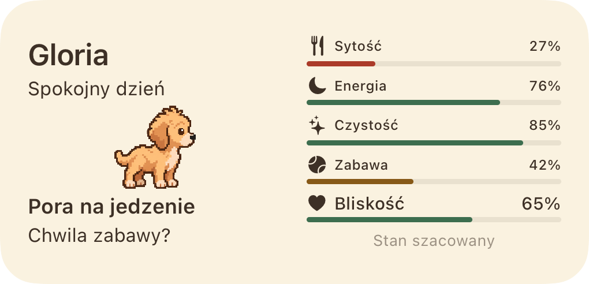

# Widget YuFriend na iPhone

WidgetKit, iOS 16 lub nowszy. Widget pokazuje prawdziwe imię psa z zapisu i korzysta z istniejących sprite’ów gry:

- **Mały:** pies stojący lub śpiący, najpilniejsza potrzeba i jej procent.
- **Średni:** nastrój z ostatniego zapisu, pięć potrzeb z paskami i procentami oraz maksymalnie dwie propozycje opieki.
- **Ekran blokady:** prostokątny widget z imieniem, najpilniejszą potrzebą i procentem.

Potrzeby poniżej 30% są czerwone, 30–59% bursztynowe, pozostałe zielone. Gdy wszystkie są zaspokojone, widget mówi „Wszystko w porządku”. Podczas snu nie proponuje drzemki. Dotknięcie widgetu otwiera aplikację; karmienie i pozostałe czynności wykonuje się w grze.

Po instalacji tej wersji otwórz grę przynajmniej raz. Następnie przytrzymaj ekran początkowy i wybierz **Edytuj → Dodaj widget → YuFriend → Twój piesek**. Widget blokady dodaje się w edytorze ekranu blokady.



Podgląd natywnego widoku na syntetycznym stanie, nie zrzut danych Glorii z telefonu.

## Dane i odświeżanie

`PetWidgetBridge.swift` uruchamia się z natywnego punktu inicjalizacji eksportu Godota. Odczytuje zatwierdzony `Documents/pet.json` (wersje zapisu od 4 wzwyż), wybiera minimalny zestaw pól i atomowo publikuje `pet-widget.json` w App Group. Nigdy nie zapisuje ani nie migruje pliku gry. Błędny lub nieobsługiwany zapis nie zastępuje ostatniego poprawnego obrazu stanu.

Most obserwuje katalog `Documents`, dzięki czemu działa również po atomowej podmianie pliku. Odczytuje stan przy starcie i wznowieniu, kontrolnie co 10 sekund w aktywnej aplikacji oraz podczas krótkiego zadania po przejściu w tło. Wywołuje `WidgetCenter.reloadTimelines` po publikacji nowego stanu. Serie zdarzeń plikowych są łączone w jedno odczytanie.

Widget wylicza prognozę co 15 minut na 8 godzin. Każda prognoza zaczyna się od oryginalnego znacznika czasu zapisu: ponowne odświeżenia nie przedłużają limitu nieobecności. Obliczenia odtwarzają `NeedsSystem`: tempo spadku, wpływ towarzyskości na bliskość, regenerację snu, wybudzenie przy 85% i dolną granicę 15%. Po 8 godzinach pokazuje prośbę o otwarcie gry. Nastrój nie jest losowany ponownie poza grą. Bez danych widget prosi o pierwsze otwarcie aplikacji.

Godzina rzeczywistego odświeżenia zależy od iOS; widget nie jest stale działającym procesem ani powiadomieniem push. Zasady: [odświeżanie WidgetKit](https://developer.apple.com/documentation/widgetkit/keeping-a-widget-up-to-date) i [App Groups](https://developer.apple.com/documentation/xcode/configuring-app-groups).

## Powtarzalny eksport

Źródła natywne są w `native/ios/`, poza generowanymi eksportami. Eksport z dołączeniem widgetu:

```sh
sh tools/export_ios.sh
```

Wynik bieżącego eksportu: `exports/ios-reminders-v10/YuFriend.xcodeproj`. Opcjonalny pierwszy argument wybiera inny katalog. Skrypt `tools/install_ios_widget.py` dodaje rozszerzenie, zależność, osadzanie `.appex`, App Groups dla obu targetów, obrazy, punkt startowy mostu oraz [lokalne przypomnienia](powiadomienia-ios.md) w aplikacji. Powtórne uruchomienie aktualizuje źródła bez powielania targetów ani wywołania startowego.

Istniejący eksport można uzupełnić poleceniem:

```sh
python3 tools/install_ios_widget.py exports/ios/YuFriend.xcodeproj
```

Domyślna grupa to `group.com.maciejkempisty.yufriend.playtest`, rozszerzenie ma bundle ID `com.maciejkempisty.yufriend.playtest.widget`. Identyfikatory wynikają z eksportowanego targetu aplikacji; `--app-group` pozwala wskazać inną zarejestrowaną grupę. Oba targety muszą mieć tę samą grupę i zespół podpisujący. Wersja i numer buildu rozszerzenia są kopiowane z aplikacji.

Sam eksport przez edytor Godota nie dodaje widgetu: po nim uruchom instalator. Nie zapisuj ręcznych poprawek wyłącznie w `exports/`, bo następny eksport je zastąpi. Samo dodanie wersji lub pól zapisu nie wymaga dopisywania numeru do czytnika. Zmiana wymaganych pól widgetu lub reguł potrzeb nadal wymaga sprawdzenia zgodności. Czytnik sprawdza typy, zakresy potrzeb, nastrój, tożsamość i znacznik czasu; błędne dane także w przyszłej wersji są odrzucane.

## Testy

```sh
sh tools/test_ios_widget.sh
```

Test uruchamia rzeczywisty `NeedsSystem` Godota dla 252 kombinacji czasu, energii, snu i towarzyskości, a następnie porównuje wynik z kodem Swift. Po zmianie 17 listopada 2026 **1546 sprawdzeń** obejmuje też błędne dane, nowy schemat, brak pliku, wybór najpilniejszej potrzeby, brak fałszywych alarmów i odczyt współdzielonego formatu.

15 listopada 2026 przeszły kompilacja iOS oraz podpisanie aplikacji i rozszerzenia z App Groups. Instalator sprawdzono przez ponowne uruchomienie i kontrolę braku zduplikowanych elementów. Pełny eksport Godota nie zlinkował się na symulator arm64: dostarczona biblioteka silnika zawierała obiekty x86_64. Natywny podgląd zbudowano i uruchomiono niezależnie od silnika; obejrzano mały i średni widget oraz sen z długim imieniem. Cztery testy mostu na symulatorze potwierdziły publikację przy starcie, aktualizację po atomowej podmianie zapisu, zachowanie poprzednich danych po uszkodzonym pliku i odebranie późnego zapisu po powiadomieniu o przejściu w tło. Wyniki: `test-results/widget/bridge-results.json`.

Build **0.1.0 (8)** zainstalowano i uruchomiono na iPhonie 15 Pro Max. Urządzenie zgłosiło właściwą App Group. Kopia `pet.json` sprzed instalacji i plik po uruchomieniu potwierdziły zachowanie imienia, identyfikatora, osobowości, cech, umiejętności, więzi, osiągnięć i wersji zapisu. Próba pobrania `pet-widget.json` przez `devicectl` została odrzucona przez politykę dostępu iOS do kontenera grupowego (błąd 11007). Dowody instalacji i porównania: `exports/ios-widget-v8/`.

**Ręczne potwierdzenie użytkownika, 15 listopada 2026:** po dodaniu widgetu na ekran początkowy, otwarciu gry, wykonaniu opieki i powrocie na ekran początkowy imię Glorii i potrzeby są poprawne. Potwierdzenie dotyczy użytkowania widgetu na telefonie; nie oznacza bezpośredniego odczytu pliku App Group przez narzędzia ani testu wszystkich rozmiarów i ekranu blokady.
