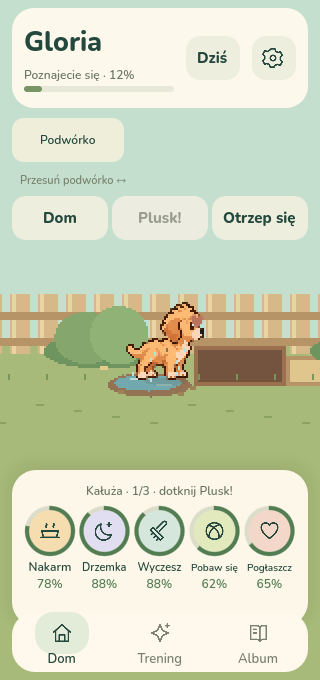
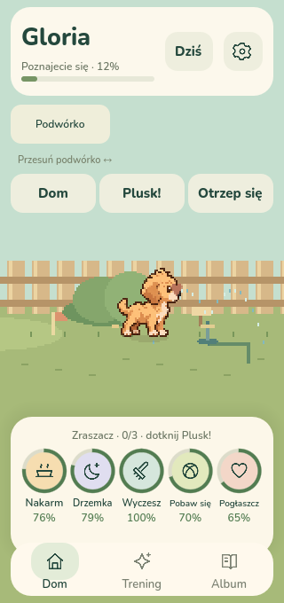

# Kałuża i zraszacz

Pakiet po buildzie 23 dodaje dwa stałe miejsca: **Kałużę** i **Zraszacz**. Podwórko ma dziesięć miejsc; widok całości pokazuje dwa rzędy po pięć pól dotykowych, także przy szerokości 320 px.

## Przebieg zabawy

Pies podbiega do wybranego miejsca. Po dojściu przycisk **Plusk!** uruchamia przebiegnięcie przez wodę. Kolejne można rozpocząć po krótkiej animacji plusku; runda ma maksymalnie trzy przebiegnięcia. **Otrzep się** kończy zabawę wcześniej. Po trzecim plusku otrzepywanie uruchamia się automatycznie. Brak aktywności przez około minutę również kończy rundę.

To licznik krótkiej rundy, nie nowy cel dzienny. Nie ma dziennej serii, limitu nagród więzi ani zadania przygody za wodę. Pierwsze rzeczywiste pluski w każdym miejscu pozostawiają jedną pamiątkę w Albumie.

## Balans i kąpiel

| Efekt jednego ukończonego przebiegnięcia | Kałuża | Zraszacz |
| --- | ---: | ---: |
| Zabawa | +4 | +4 |
| Energia | −2 | −2 |
| Czystość | −12 | −3 |
| Dodatkowa więź | 0 | 0 |

Do rozpoczęcia potrzeba co najmniej 45 energii i 30 sytości. Po rzeczywistym plusku obowiązuje wspólna 60-sekundowa przerwa od wody, liczona podczas działania gry. Pozostałe zabawy i kąpiel pozostają dostępne. Koszt i pamiątka zapisują się przy dojściu na drugi brzeg, tylko raz; wyjście po plusku nie usuwa błota. Przerwane podejście lub niedokończone przebiegnięcie nie nalicza efektu. Błąd zapisu cofa tylko niedawno naliczaną zmianę i kończy rundę.

Otrzepywanie usuwa widoczne krople, ale nie podnosi czystości. Po trzech przejściach przez kałużę ze 100 czystości zostają 64 punkty, co pozwala rozpocząć istniejącą kąpiel. Kąpiel nadal daje +45 czystości do maksimum 100, kosztuje 5 energii i 2 sytości, wymaga energii ≥35, sytości ≥30 oraz czystości <80. Po lżejszej zabawie w zraszaczu może wystarczyć czesanie. Komunikat po otrzepaniu uwzględnia gotowość do kąpieli — nie nakazuje kąpać zmęczonego psa.

Noc, zmęczenie poniżej 28 energii, powrót do domu i przejście aplikacji w tło przerywają wodę oraz usuwają efekty. Dotychczasowy nocny powrót i odpoczynek działają dalej. Wizyta gościa może ustąpić wybranej przez gracza zabawie w wodzie; nowe wizyty nie przerywają rundy.

## Grafika i animacje

Grafiki są edytowalnymi elementami rysowanymi w kodzie, w siatce 3 jednostek świata używanej przez podwórko. Nie są zastępczymi plikami ani zewnętrznymi obrazami. `scripts/ui/yard_water_view.gd` rysuje błotnisty brzeg i odbicia kałuży, zraszacz z wężem, łuki strumieni i krople. Woda na ziemi jest za psem, a krople nad sierścią na osobnej warstwie. Tło pokoju nie jest przez to przerysowywane w każdej klatce. Efekty zatrzymują się, gdy nie są widoczne.

Pies korzysta z istniejących klipów `run`, `play_bow` i `shake`. Ruch przy klipie `run` nie jest już zatrzymywany przez ogólną metodę odtwarzania animacji. Brud korzysta z dotychczasowego materiału sierści i wskaźnika higieny.

## Dane i sprawdzanie

`YardWater` przechowuje tylko stan bieżącej rundy i krótki odstęp między rundami. Nie dodaje pola do pieska ani nowej migracji: schemat pozostaje v15. Potrzeby i dwie pamiątki używają istniejącego zapisu. Testy: `tests/test_water.gd` i `tests/ui_water.gd`; obejmują rzeczywiste dojście w UI, powtórne dotknięcia, anulowanie, tło, noc, zmęczenie, błąd zapisu, koszty, animację otrzepywania i istniejącą kąpiel.

Weryfikacja 17 listopada 2026: 25 zestawów logiki i 19 zestawów interfejsu zakończyło się kodem 0, bez nieudanych sprawdzeń. W tym nowe testy wody: 71 sprawdzeń logiki i 104 interfejsu. Pierwszy przebieg `ui_rhythm` zgłosił przy zamykaniu pozostawione zasoby Godota mimo 17 udanych sprawdzeń; osobne powtórzenie zakończyło się bez tego komunikatu i ponownie przeszło wszystkie 17 sprawdzeń.

Na kopii ostatniego backupu Glorii z builda 23 sprawdzono zapis i odczyt wszystkich 29 pól v15. Po pełnej rundzie wody zmieniły się wyłącznie potrzeby, czas zapisu i pierwsza pamiątka; wcześniejsze postępy i wpisy Albumu zostały zachowane. Oryginalnego backupu ani danych telefonu nie modyfikowano.

Pakiet jest wdrożony lokalnie. Ostatni build zainstalowany na telefonie to 23; nie wykonano nowej instalacji w ramach tego zadania. Testy dotyku i wyglądu na fizycznym iPhonie pozostają do sprawdzenia przy następnym buildzie.
